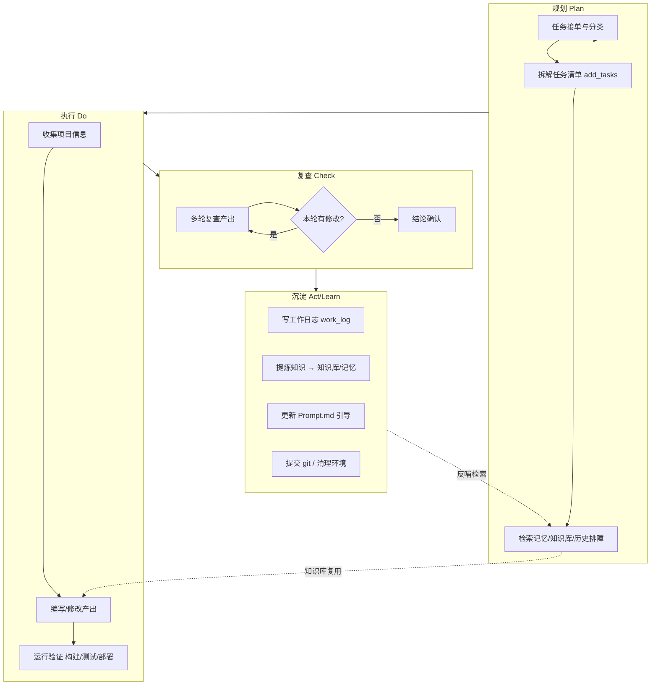
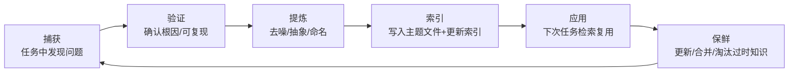
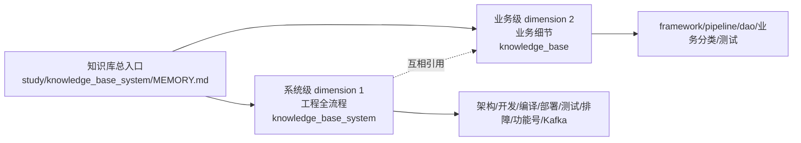

# 大模型 Agent 自我进化体系 —— 工作 / 学习 / 总结 / 知识库一体化方案

> 目标：让 Agent 在日复一日的文档、代码、测试、部署、运维任务中，不断学习、不断成长，变得越来越聪明、智能、可靠。
> 核心思想一句话：**把每一次任务都变成一次"学习 + 沉淀 + 反哺"的机会，形成一个自我强化的封闭闭环。**
> 适用场景：本仓库（OTC 场外基金交易系统）的日常开发运维 + 长期知识积累。

---

## 0. 总览：一张图看懂整个体系



**四条主线（对应四个问题）：**

| 主线 | 回答的问题 | 落点 |
|------|-----------|------|
| ① 工作流程 | 怎么把事做对、做快、可复现 | 任务五阶段 + 分类执行清单 |
| ② 学习流程 | 怎么把"做过的事"变成"会做的事" | 三层记忆模型 + 主动学习钩子 |
| ③ 总结流程 | 怎么把"经验"提炼成"知识" | 结构化复盘 + 知识生命周期 |
| ④ 知识库构建 | 怎么存、怎么找、怎么保鲜 | 分层架构 + 索引优先 + 保鲜机制 |

---

## 1. 核心理念

### 1.1 三层记忆模型（模拟人脑记忆）

Agent 的记忆应分层，不同层有不同的读写频率和生命周期：

| 记忆层 | 类比 | 内容 | 位置 | 读写频率 |
|--------|------|------|------|----------|
| **工作记忆** | 短期 | 当前任务的上下文、临时状态、进行中的文件 | 对话上下文 + `add_tasks` 任务清单 | 最高 |
| **情景记忆** | 经历 | 每次任务做了什么、遇到什么问题、怎么解决的 | `work_log/YYYYMMDD.md` | 高 |
| **语义记忆** | 知识 | 提炼出的模式、架构、坑点、规则（跨会话复用） | `memory/*.md` + `study/knowledge_base_system/` | 中 |
| **程序性记忆** | 技能 | 怎么做某类事的"标准流程/How-to" | `Prompt.md` + 各 `*.md` 的执行规范 | 低（稳定） |

> **关键原则**：原始经历（情景）进 work_log，提炼后的规律（语义）进知识库，固化下来的流程（程序）进 Prompt.md。三者逐层提纯，逐层稳定。

### 1.2 知识生命周期（Knowledge Lifecycle）

一条知识从产生到淘汰，经历完整的生命周期，每一环都要有明确动作：



- **捕获**：任务执行中遇到的报错、坑、好模式，随手记录（可先记在 work_log）。
- **验证**：根因是否确认？能否复现？是否经实测？（**禁止把未经证实的猜测写进知识库**）
- **提炼**：去掉个案细节，抽象成可复用规律；给一个清晰的名字。
- **索引**：写入对应主题文件，并在 `MEMORY.md` 更新速查条目，确保"可被找到"。
- **应用**：下次任务通过索引检索到并复用，验证其有效性。
- **保鲜**：定期检查——过时的删除、重复的合并、新增的补充。

### 1.3 学习收益最大化原则

- **一次任务，三份产出**：① 任务交付物；② 工作日志条目；③ 提炼后的知识条目。缺一不可。
- **宁精勿滥**：知识库是"复用资产"，不是"垃圾桶"。只沉淀**经过验证、可复用、有区分度**的内容。
- **索引 > 内容**：内容再多，找不到等于没有。`MEMORY.md` 是知识库的"搜索引擎"。

---

## 2. 工作流程规范（执行层）

### 2.1 任务五阶段

每个任务都走五阶段，形成肌肉记忆：

```
阶段1 接单分类  → 阶段2 规划      → 阶段3 执行验证  → 阶段4 复查    → 阶段5 沉淀提交
```

**阶段1：接单分类**
- 判断任务类型：**编码 / 项目问答 / 通用问答 / 模糊任务**。
- 编码类 → 先收集项目信息；通用问答 → 直接回答不调工具；模糊任务 → 先澄清。
- 判断是否需要 docker、是否需要编译部署、是否跨主机。

**阶段2：规划**
- 复杂任务用 `add_tasks` 拆解成可追踪的子任务（id + 状态）。
- **先检索记忆/知识库/历史排障**（`memory/*.md`、`study/knowledge_base_system/`、`task/global_node/global_test.md` 等），看有没有现成答案。
- 明确验收标准（"什么叫完成"）。

**阶段3：执行验证**
- 改动前先读相关文件（`get_file_content`），不凭空猜测。
- 修改用 `replace_in_file` 精准编辑，创建新文件用 `write_to_file`。
- **必须验证**：能编译的编译、能测试的测试、能部署的部署。文档类检查引用与格式。
- 开发测试一律在 docker `otc` 容器内 + CMake 重新编译部署，防旧库干扰。

**阶段4：复查（多轮）**
- 对所有产出（代码/SQL/测试/文档）逐轮复查，查漏补缺。
- 本轮有修改 → 再开一轮；直到某轮**零修改**为止。
- 复查重点：逻辑正确性、边界情况、与现有代码风格一致、引用路径正确、命名统一。

**阶段5：沉淀提交**
- 写工作日志 → 提炼知识 → 更新 Prompt.md → git 提交（含工作日志一起提交，防漏）→ 关闭 docker。

### 2.2 分类执行清单（每类任务的特有检查点）

| 任务类型 | 特有检查点 |
|---------|-----------|
| **文档** | 结构完整（背景/流程/代码/测试/结论）、引用路径真实、Mermaid 图渲染正确、与代码一致、无过时信息 |
| **编码** | 编译通过、遵循现有架构（LBM/Atom/DAO）、命名风格一致、边界处理、`make` 后必须 `make install` |
| **测试** | 先清空内存库防旧数据干扰、构造触发路径（如死循环测试必须插入触发条件）、断言覆盖正反向用例 |
| **部署** | 平台差异（x86/arm）、路径可移植性、依赖库完备（ldd）、启停脚本四命令验证、环境变量（ATP_DATA 等） |
| **运维排障** | 先看日志定位根因、不猜测、修复后回归验证、把根因沉淀到排障文档 |

---

## 3. 学习流程（学习层）

### 3.1 主动学习 vs 被动学习

- **被动学习**（任务驱动）：遇到新功能/新模块，先研究它，产出分析文档（如 `study/<功能号>_<业务名>/`）。这是主要来源。
- **主动学习**（计划驱动）：定期回顾 `task/task_all.txt`、`global_node_task.txt` 等任务清单中的"知识库任务"，或对不熟悉的领域（Kafka、DBF、Hare 总线）做专项研究。

### 3.2 任务中的学习钩子

每次任务执行时，刻意问自己三个问题，把"做事"变成"学事"：

1. **这是什么？**（功能/模式/模块的定位与职责）
2. **怎么用/怎么配？**（关键路径、配置项、命令）
3. **坑在哪？**（报错、边界、易错点）

答案随手记，任务后统一提炼。

### 3.3 知识库反哺学习：Prompt.md 的演进

`Prompt.md` 是"学习引导器"，它应该随知识库一起演进：
- 每次新增重要知识，同步在 Prompt.md 的「学习路径」「学习要求」「学习完成标准」中补充。
- 这样**新会话/新主机的 Agent 只要读一遍 Prompt.md，就能继承全部历史积累**，实现"知识跨会话迁移"。

> 这是本方案最核心的机制：**知识不随会话结束而丢失，而是沉淀在仓库里，通过 Prompt.md 被下一个会话的 Agent 重新加载。**

---

## 4. 总结流程（反思层）

### 4.1 结构化复盘模板

每次任务完成后，按固定模板复盘，避免"流水账"：

```markdown
## 任务：<一句话描述>
**时间**：HH:MM-HH:MM

### 工作内容
1. <做了什么>
2. <关键动作/决策>

### 结论/效果
<达成了什么，验证了什么>

### 经验教训（可复用/可学习点）
1. <教训1：现象 → 根因 → 解法>
2. <教训2：...>

### 待验证假设（可选）
<未完全确认、留待下次验证的推测>
```

### 4.2 从"经验"到"知识"的提炼方法（三级提炼）

```
原始经验（work_log，详细、含过程）
   ↓ 提炼1：去噪 —— 去掉时间戳、个案细节、过程性噪声
   ↓ 提炼2：抽象 —— 提取"现象→根因→解法"的通用规律，给个名字
   ↓ 提炼3：索引 —— 归入主题文件 + 更新 MEMORY.md 速查 + 更新 Prompt.md
知识（可复用的语义记忆）
```

**判断标准**：一条经验能否成为知识？问自己——
- 它是否**经过验证**（实测/根因明确）？→ 否，则只留在 work_log 或标"待验证"。
- 它是否**可复用**（下次还会遇到）？→ 否，则不沉淀。
- 它是否**已有类似条目**？→ 是，则合并而非重复新增。

### 4.3 四级复盘体系（参考 agent_upgrade.md 升级）

将"单任务复盘"升级为**四级复盘**，是自进化的核心环节：

| 级别 | 频率 | 内容 |
|------|------|------|
| **单任务即时复盘** | 每次任务后（必做） | 用"复盘核心五问"轻量复盘单次任务得失 |
| **每日总结复盘** | 每日 | 汇总当日任务，统计高频问题/新增技能/能力短板 |
| **每周迭代复盘** | 每周 | 迭代 SOP、优化 Skill、清理无效知识、补充缺失能力 |
| **每月能力升级复盘** | 每月 | 盘点能力体系，对比基线，评估成长，制定下月计划 |

**复盘核心五问**（单任务必问）：
1. 本次任务是否完全达标？有哪些瑕疵？
2. 执行中哪些步骤高效、可固化复用？
3. 出现了哪些报错/卡点/低效问题？根因是什么？
4. 下次同类任务如何优化流程、规避问题？
5. 需要新增/优化哪些 Skill、知识库条目？

**复盘成果五转化**（固化规范）：
- 高效经验 → 标准化 Skill/流程模板；
- 报错踩坑 → 问题解决方案知识库（现象→根因→解法）；
- 流程瑕疵 → 优化通用工作 SOP（task_rule.md）；
- 能力短板 → 靶向学习清单；
- 优质案例 → 标杆案例库。

> 详细规则见 `task/task_rule.md` §7。

### 4.4 分场景专项工作规范

| 场景 | 专项 SOP |
|------|---------|
| **文档类** | 需求梳理→结构搭建→内容填充→逻辑校验→格式统一→图表补充→合规自检→归档 |
| **代码开发** | 需求拆解→技术选型→架构设计→编码实现→注释完善→单元测试→重构→规范校验→提交部署 |
| **测试运维** | 环境校验→脚本执行→日志采集→异常筛查→问题定位→修复验证→告警推送→巡检归档 |

### 4.3 多轮复查机制（用户明确要求，必守）

- 对**所有产出**（代码/SQL/测试/文档）执行多轮复查。
- 每轮复查该轮涉及内容，查漏补缺。
- 只要本轮修改了任一内容，就**再开一轮全面复查**，直到某轮零修改。
- 复查不仅是"看"，更要"验证"（编译/测试/跑通）。

---

## 5. 知识库构建（存储层）

### 5.1 分层架构设计

| 层 | 目录 | 内容 | 特点 |
|----|------|------|------|
| **L0 记忆索引（快速）** | `memory/`（`/home/lsz/.chat/projects/.../memory/`） | `MEMORY.md` 索引 + 主题笔记（跨会话自动加载） | 最热、最精简、自动加载进上下文 |
| **L1 系统级知识库** | `study/knowledge_base_system/` | 架构/开发/编译/部署/测试/排障/功能号/Kafka，10 文件 | 系统化、按主题组织、供学习 |
| **L2 业务级知识库** | `study/knowledge_base/` | 基金投顾等业务的功能号/新旧映射 | 业务维度 |
| **L3 深度专题** | `study/<功能号>_<业务名>/` | 每个功能的技术实现/测试案例/设计文档 | 深度、一次性研究 |
| **L4 原始日志** | `work_log/YYYYMMDD.md` | 每天工作流水 + 经验教训 | 原始、按时间、追加不覆盖 |

**读写方向**：
- 写入：任务完成 → 先写 L4（work_log）→ 提炼进 L0/L1/L2/L3。
- 读取：任务开始 → 先读 L0（memory，自动加载）→ 按需读 L1/L2 → 深入读 L3 → 查细节读 L4。

### 5.2 索引优先设计（重中之重）

- `MEMORY.md` 是所有知识库的"入口搜索引擎"，必须保持精简、正确、最新。
- 规则：**超过 200 行的内容会被截断**，因此 `MEMORY.md` 必须控制长度，只放：
  - 主题文件导航表；
  - 核心结论速查（高频可复用的结论）；
  - 关键路径速查；
  - 工作准则。
- 详细笔记放独立主题文件，在 `MEMORY.md` 中引用。

### 5.3 原子化、主题化、去重、保鲜

- **原子化**：一个主题一个文件，便于定位和复用。
- **主题化**：按"架构/开发/编译/部署/测试/排障/功能号"等语义主题组织，而非按时间。
- **去重**：写入新知识前，先检查是否有可更新的现有条目，避免重复。
- **保鲜**：
  - 知识过时（架构变更、配置改版）→ 更新或删除；
  - 用户纠正你基于记忆的陈述 → 必须更新/删除错误记忆；
  - 未经证实的结论 → 不写，或明确标注"待验证"。

### 5.4 与现有目录的映射关系

| 现有机制 | 在本方案中的角色 | 升级建议 |
|---------|----------------|---------|
| `work_log/YYYYMMDD.md` | L4 情景记忆 | 保持追加不覆盖；统一复盘模板 |
| `study/knowledge_base_system/` | L1 系统知识库 | 保持主题化；定期保鲜 |
| `study/knowledge_base/` | L2 业务知识库 | 保持 |
| `study/<功能号>_<业务名>/` | L3 深度专题 | 保持 |
| `memory/` | L0 记忆索引 | 保持"索引+主题文件"模式 |
| `Prompt.md` | 程序性记忆/学习引导 | **每次沉淀后同步更新**，实现跨会话知识迁移 |
| `task/task_all.txt` 等 | 任务清单 + 工作准则 | 作为"主动学习"来源 |
| `task/global_node/global_test.md` 等 | 详细排障记录 | 排障经验提炼进 L1/L0 后，此处保留原始细节 |

---

## 6. 工具与自动化

### 6.1 现有工具盘点（已具备）

| 工具/机制 | 用途 |
|----------|------|
| `add_tasks` / `update_tasks` | 任务规划与追踪 |
| `list_files` / `search_relative` / `get_file_content` | 高效检索代码/文档 |
| `replace_in_file` / `write_to_file` | 精准编辑 |
| `run_command` | 构建/测试/部署/git |
| `get_file_problems` / `find_def_locations` | 编译问题与符号定位 |
| `memory/` 目录 | 跨会话记忆 |
| `commit_code` | 提交工作流 |
| MCP（kjptmcp-server） | 任务/Story 查询流转 |

### 6.2 建议引入的外部工具

| 工具 | 名称 | 用途 | 使用方式 |
|------|------|------|---------|
| 知识库可视化 | **Obsidian**（本地 markdown 笔记） | 把 `study/`、`memory/` 变成双向链接知识图谱，便于人机共同浏览检索 | 将仓库作为 Obsidian vault 打开，用 `[[双向链接]]` 关联主题 |
| 知识库可视化（备选） | **Notion / Logseq** | 同上，适合团队协作 | 导入 markdown |
| 全文检索 | **ripgrep / ripgrep-all** | 仓库内快速全文搜索（比 IDE 搜索更快） | `rg "关键字" study/` |
| 图表 | **Mermaid**（已用） | 流程图/时序图/类图 | markdown 内嵌 ```` ```mermaid ```` |
| 文档格式 | 现有 **docx/xlsx/pdf** skill | 产出专业交付物 | 按需调用对应 skill |
| 定时复盘提醒 | **cron / 计划任务** | 每周自动触发"知识库保鲜+主动学习" | 定时跑一个脚本扫描过时知识 |

### 6.3 自动化钩子（可脚本化）

- **知识保鲜脚本**：扫描 `study/` 下文档的"最后修改时间"，筛选超过 N 天未更新的主题，提示复核。
- **工作日志模板生成**：`work_log/YYYYMMDD.md` 不存在时自动创建带当日日期的模板。
- **提交检查**：`commit_code` 前检查工作日志是否已更新（防"提交后工作日志没提交"）。
- **环境清理**：docker 用完后自动 `docker stop`，减少机器消耗。

---

## 7. 自我改进与可靠性

### 7.1 反馈闭环与量化

让"变聪明"可度量，建立简单的质量指标（可记在 `memory/` 或 `work_log` 汇总）：

| 指标 | 含义 | 改进动作 |
|------|------|---------|
| 重复问题解决率 | 同类问题第二次是否更快/免排障 | 若仍踩坑，说明知识未沉淀到位 |
| 知识复用命中率 | 任务开始检索知识库找到现成答案的比例 | 若低，说明索引不完善 |
| 复查轮次 | 平均几轮复查才零修改 | 轮次高说明一次做对率低，需加强规划 |
| 排障耗时 | 从报错到定位根因的时间 | 沉淀高频排障到 L1 |
| 返工率 | 提交后被发现要改的比例 | 提高阶段3验证质量 |

### 7.2 错误驱动学习（最重要）

**每一次报错、失败、返工，都是最高价值的学习素材。** 强制流程：
1. 记录报错原文（现象）。
2. 定位根因（不猜测，看日志/复现）。
3. 给出解法并验证。
4. 把"现象→根因→解法"沉淀为可检索的知识（L1 排障 / L0 速查）。

> 例：本仓库 `MEMORY.md` 里大量"根因="条目（rmem_max、表结构不匹配、libodbc.so.2、死循环修复等），正是错误驱动学习的成果。**这套机制要继续强化。**

### 7.3 可靠性保障

- **验证优先**：所有结论要有依据（编译通过、测试通过、日志证据、实测复现），不凭猜测下结论。
- **守卫原则**：改动前读文件、改动后验证；高风险操作（删数据/改历史/装依赖）先确认。
- **保护用户改动**：不覆盖用户已有工作，忽略无关变更。
- **冗余与可追溯**：work_log 保留原始细节，知识库保留提炼结论，两者互为备份，可追溯。
- **及时纠错**：用户纠正你基于记忆的陈述时，立即更新/删除错误记忆。

### 7.4 复盘自动化分析（能否自动触发？）

**核心结论**：Agent 是被动响应式，**无法自行唤醒**。当前环境无 headless agent CLI（claude/devchat/aicode 均不可用），cron 只能跑 shell 脚本、**无法启动 agent 会话**。因此四级复盘并非全部能自动触发：

| 级别 | 自动化程度 | 说明 |
|------|-----------|------|
| **单任务即时复盘** | ✅ 全自动 | 内嵌于任务收尾流程（自检清单），无需外部触发 |
| **每日总结复盘** | ⚠️ 半自动 | 需 cron 备数据 + 用户触发 agent 会话 |
| **每周迭代复盘** | ⚠️ 半自动 | 同上 |
| **每月能力升级复盘** | ⚠️ 半自动 | 同上 |

**为什么不能全自动**：
1. Agent 只在用户通过 IDE 会话发消息时运行，是**响应式**而非**自主式**。
2. 无 headless CLI（`claude`/`devchat`/`aicode` 均不在 PATH），cron 无法"叫醒" agent。
3. cron 能跑 shell 脚本，但脚本无法驱动带工具能力的 agent 会话。

**半自动方案（推荐，已实现 `task/review/review_prepare.sh`）**：
- cron 定时**自动聚合数据**（work_log → 复盘输入文件 + 触发 prompt）；
- 用户**一键触发**：复制触发 prompt 或说"进行<周期>复盘"；
- agent 执行**反思环节**（核心五问 → 成果五转化 → 更新知识库/Prompt.md → 写报告）。
- 这样把"数据准备"自动化，把"反思"保留给 agent（需工具能力更新知识库），用户只需一步触发。

**可选全自动文本复盘（不推荐作主机制）**：
- cron 脚本直接调用模型 API（`http://aicode.gtht.com.cn/v1`）发纯文本复盘请求，生成文本报告。
- 局限：无工具能力，不能更新知识库/文件，只产出文本报告。适合轻量每日复盘，不适合深度复盘。

**若未来想实现真全自动**：需引入 headless agent CLI（如 `claude -p` / `devchat headless`），由 cron 调用它执行复盘；当前环境不具备，列为后续增强项。

> 落地规则见 `task/task_rule.md` §7.4；脚本见 `task/review/review_prepare.sh`。

---

## 8. 落地路线图（分阶段实施）

| 阶段 | 动作 | 产出 |
|------|------|------|
| **P0 固化准则** | 把本方案的核心准则并入 `task/task_all.txt` 工作准则 | 统一行为基线 |
| **P1 统一模板** | 建立工作日志模板、复盘模板、知识文件模板（见附录） | 模板库 |
| **P2 索引完善** | 检查 `MEMORY.md`/`Prompt.md` 是否覆盖最新知识，补齐 | 索引最新 |
| **P3 保鲜机制** | 引入知识保鲜脚本 + 每周主动学习复盘 | 保鲜脚本 |
| **P4 工具接入** | 按需引入 Obsidian/ripgrep 等外部工具 | 工具链 |
| **P5 量化改进** | 建立质量指标，定期回顾改进 | 指标看板 |

---

## 9. 知识库融合方案（knowledge_base + knowledge_base_system）

### 9.1 现状分析

当前存在两个知识库，**分工不同、互补重叠**：

| 知识库 | 定位 | 内容 | 引导 Prompt | 引用路径 |
|--------|------|------|------------|---------|
| `study/knowledge_base/` | **业务级**（每个业务是啥） | framework / pipeline_pattern / dao_tables / business_index / business_*(rollback/advisory/asset_query/risk/seamless) / testing | `LEARNING_PROMPT.md` | 旧路径 `otc_trunk`（**已过时，需更新**） |
| `study/knowledge_base_system/` | **系统级**（怎么在系统上干活） | 01~09（架构/开发/编译/部署/测试/排障/功能号/Kafka） | `Prompt.md` | 当前 `otc_src` |

**重叠点**：两边都有"架构/开发模式/测试/功能号"主题（如 `framework.md` vs `02_业务开发模式.md`、`business_index.md` vs `08_功能号索引.md`）。

### 9.2 融合思路：统一为"一个知识库，两级维度"

两个知识库不是二选一，而是**同一知识体系的两个正交维度**，应建立统一框架：



- **维度1（工程环节，系统级）**：回答"怎么在系统上干活"——架构、开发、编译、部署、测试、排障、功能号、Kafka。由 `knowledge_base_system/` 承载。
- **维度2（业务域，业务级）**：回答"每个业务是啥"——功能号、调用链路、出入参、核心表、新旧映射。由 `knowledge_base/` 承载。

### 9.3 融合落地步骤

1. **统一入口索引**：在 `knowledge_base_system/MEMORY.md` 增加"业务域知识库"导航章节，指向 `study/knowledge_base/`，使两个知识库共享一个总入口。
2. **统一引导 Prompt**：新建/合并一份**总引导 Prompt**，学习路径分"系统级 → 业务级"两级，覆盖两个知识库（`Prompt.md` 作为总引导，引用 `knowledge_base/LEARNING_PROMPT.md` 作为业务级子引导）。
3. **明确分工消除重叠**：
   - 系统级管"开发模式/功能号总表"（怎么开发、功能号分类）；
   - 业务级管"具体业务细节/出入参/调用链路"（某功能号具体做什么）。
   - 重叠主题在各自文档中**互相引用**而非重复，避免双维护。
4. **统一路径**：更新 `knowledge_base/` 中过时的 `otc_trunk` 引用为当前 `otc_src`，消除路径歧义。
5. **统一保鲜**：两个知识库共用同一套保鲜机制（超期未更新提示、纠错更新、去重）。

### 9.4 融合后的知识库体系全景（L0~L5）

```mermaid
flowchart TB
    L0[L0 记忆索引 memory/] --> L1[L1 系统级知识库 knowledge_base_system]
    L1 --> L2[L2 业务级知识库 knowledge_base]
    L2 --> L3[L3 深度专题 study/功能号_业务名]
    L3 --> L4[L4 原始日志 work_log]
    L0 -.总入口 MEMORY.md.-> L1
    L1 -.总引导 Prompt.md.-> L2
```

> 融合后，`knowledge_base` 不再是"孤立目录"，而是作为**业务级维度**并入统一知识库体系，由总入口 `MEMORY.md` 和总引导 `Prompt.md` 统一管理。

---

## 10. 工作日志机制纳入

用户明确要求：**work_log 已设置开始记录每次的工作日志**，需纳入本体系。

### 10.1 工作日志在体系中的定位

- `work_log/YYYYMMDD.md` = **L4 情景记忆**（原始经历层），是知识沉淀的**源头**。
- 规则（来自 `task/task_all.txt` 工作准则）：
  1. 每完成一次工作，记录工作日志（时间、内容、效果、经验教训，分块记录）；
  2. **不删除**现有日志内容（可能来自其他主机/他人），**只能追加**；
  3. 文件夹无该日期文件则创建 `work_log/YYYYMMDD.md`（格式 `YYYYMMDD.md`）；
  4. 所有产出须多轮复查；
  5. 每次工作完成后总结经验教训，更新知识库 + Prompt.md。

### 10.2 工作日志与知识库的衔接（三级提炼的源头）

```
work_log（原始经历，按天）
   ↓ 提炼1 去噪、提炼2 抽象、提炼3 索引
知识库（语义记忆，可复用）
```

- **写入方向**：任务完成 → 先写 work_log → 提炼进 memory / knowledge_base / knowledge_base_system → 更新 Prompt.md。
- **读取方向**：任务开始 → 读 memory（自动加载）→ 按需读知识库 → 查细节读 work_log（历史排障）。

### 10.3 工作日志的自动化保障

- **模板生成**：`work_log/YYYYMMDD.md` 不存在时自动创建带当日日期的模板。
- **提交检查**：`commit_code` 前检查工作日志是否已更新，防"提交后工作日志没提交"。
- **日志格式统一**：使用附录 9.1 的模板（任务/时间/内容/结论/经验教训）。

---

## 11. 附录：模板库

### 9.1 工作日志模板（`work_log/YYYYMMDD.md`）

```markdown
# 工作日志 YYYY-MM-DD

## 任务：<一句话描述>
**时间**：HH:MM-HH:MM

### 工作内容
1. ...
### 结论
...
### 经验教训
1. 现象 → 根因 → 解法
---

## 任务：...
```

### 9.2 知识文件模板（`memory/xxx.md` 或 `study/.../*.md`）

```markdown
# <主题名>

## 1. 是什么 / 定位
## 2. 关键路径 / 配置
## 3. 运行流程（Mermaid 图）
## 4. 常见坑 / 排障
## 5. 关键结论速查
```

### 9.3 复盘模板

```markdown
## 本次任务复盘
- 目标：...
- 结果：成功/部分/失败
- 做得好的：...
- 可改进的：...
- 沉淀的知识：<指向知识文件条目>
- 待验证假设：...
```

### 9.4 Prompt.md 更新清单（每次沉淀后对照）

- [ ] 学习路径中是否需补充新主题？
- [ ] 学习要求中是否需补充新模式/新坑？
- [ ] 学习完成标准中是否需补充新验收点？
- [ ] 关键结论速查是否需更新？

---

## 附：本方案与现有体系的关系

本方案**不是推翻重建**，而是在现有良好基础上做**系统性升级**：
- 现有工作日志、知识库、记忆、复查、Prompt.md 机制**全部保留并强化**；
- 新增的是：**三层记忆模型、知识生命周期、结构化复盘、索引优先、知识保鲜、量化改进、外部工具**。
- 一句话总结：**让"每次任务 → 沉淀 → 反哺"成为一个可循环、可度量、可持续的自进化闭环。**