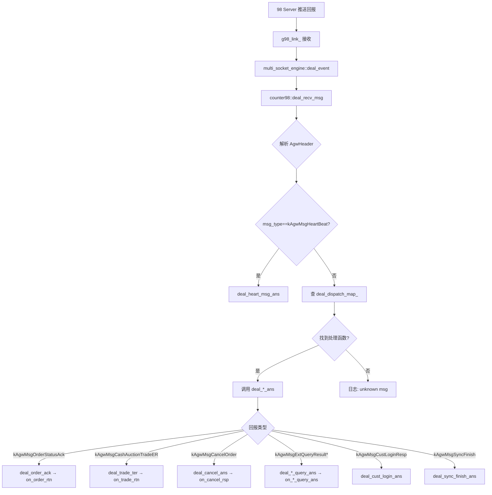
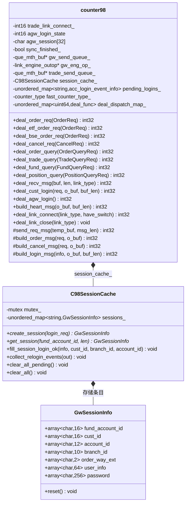
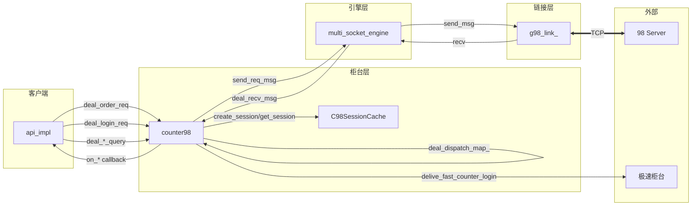

# 98 柜台（counter98）深入分析

> 源文件：`src/counter98.h` + `src/counter98.cpp`
> 缓存类：`src/c98_session_cache.h`
> 协议：98 AGW 协议（lb_counter98 命名空间）
> 设计文档：`doc/counter98.md`

---

## 1. 概述

**counter98** 是 98 柜台协议对象，对接传统 98 普通柜台系统。在整个 NewAPI 框架中承担三个核心角色：

1. **登录统一入口**：所有柜台（GOne/GW/98）的登录流程都从 counter98 发起
2. **查询唯一通道**：所有查询类业务（委托/成交/资金/持仓等）只走 98 柜台
3. **降级目标**：当极速柜台（GOne/GW）离线或不支持时，业务降级到 98 柜台处理

### 1.1 协议特征

| 特性 | 说明 |
|------|------|
| 协议 | 98 AGW TCP Binary（`lb_counter98` 命名空间） |
| 报文格式 | `[AgwHeader 16B \| Body 变长 \| CheckSum 4B]` |
| 消息头 | `raw_agw_header`（msg_type/msg_ver/reserver/seq_num/body_length） |
| 校验和 | Header + Body 逐字节求和 %256，网络字节序追加 |
| 编码 | `SerializeBuffer` + `MessageEncoder` → `msg.Encode(encoder)` |
| 解码 | `MessageDecoder(body, len)` → `msg.Decode(decoder)` |
| 消息类型 | kAgwMsgLogin(agw登录) / kAgwMsgCustLoginReq(账户登录) / kAgwMsgOrderStatusAck(委托回报) / kAgwMsgCashAuctionTradeER(成交回报) 等 |
| 字节序 | 协议头 body_length 使用网络字节序（`HostToNetwork`） |
| 变长消息 | 大部分消息体为变长（SerializeBuffer 编码），`C98_MAX_MSG_LEN=2048` |

### 1.2 消息分发表（Factory 替代 switch-case）

```cpp
// 下行消息分发表：msg_type + msg_ver → deal_* 函数指针
std::unordered_map<uint64, deal_func> deal_dispatch_map_;

// 注册宏
#define REGISTER_DEAL_FUNC(msg_type, msg_ver, func) \
  deal_dispatch_map_[make_dispatch_key(msg_type, msg_ver)] = &counter98::func;
```

`init_dispatch_map()` 注册所有已知下行消息。新增消息只需加一行宏，无需修改 `deal_recv_msg` 的 switch-case。

---

## 2. 类结构

### 2.1 核心成员

```cpp
class counter98 {
  // ---- 链接与登录状态 ----
  int16 trade_link_connect_ = 0;  // 98 链接状态: 0-断开, 1-已链接
  int16 agw_login_state = 0;      // AGW 用户登录状态: 0-未登录, 1-登录中, 2-登录成功
  char agw_session[32];           // AGW 登录成功返回的会话号
  bool sync_finished_ = false;    // 回报同步是否已完成

  // ---- 队列与引擎操作 ----
  que_mth_buf *gw_send_queue_;    // 98 柜台发送队列（所有 98 消息走此队列）
  link_engine_outop *gw_eng_op_;  // 98 链接引擎操作
  que_mth_buf *trade_send_queue_; // 极速柜台发送队列（级联登录用）

  // ---- 缓存 ----
  std::unordered_map<std::string, acc_login_event_info> pending_logins_; // 登录事件缓存
  C98SessionCache session_cache_; // 98 账户登录缓存（实例缓存，非全局单例）

  // ---- 配置 ----
  counter_type fast_counter_type_; // 极速柜台类型（决定级联登录目标）
  int32_t agw_user_login_timeout_; // AGW 登录超时（默认 10s）
  std::string agw_user_;           // AGW 用户名
  std::string agw_password_;       // AGW 密码
  std::map<uint8_t, int32_t> counter98_report_sync_; // 回报同步配置

  // ---- 下行消息分发表 ----
  std::unordered_map<uint64, deal_func> deal_dispatch_map_;
};
```

### 2.2 C98SessionCache（账户登录缓存）

```cpp
class C98SessionCache {
  // 以 fund_account_id 为 key 的实例缓存（counter98 成员，非全局单例）
  std::unordered_map<std::string, GwSessionInfo> sessions_;
  std::mutex mutex_;

  // 核心方法
  GwSessionInfo* create_session(const acc_login_event_info &login_req);  // 凭据暂存
  GwSessionInfo* get_session(const char *fund_account_id, size_t len);   // 查找
  void fill_session_login_ok(info, cust_id, branch_id, account_id);      // 登录成功回填
  void collect_relogin_events(vector<acc_login_event_info> &out);        // 断链重登收集
  void clear_all_pending();   // 断链：仅清在途
  void clear_all();           // 全量清除（实例销毁时）
};
```

> **设计契约**：条目在登录事件处理时创建（`create_session`），永不删除；身份字段（cust/account/branch）以 98 登录成功应答为权威源回填（`fill_session_login_ok`），值不变不写（RUL-15）维持发布屏障。

---

## 3. 核心流程

### 3.1 启动与 AGW 登录

```mermaid
sequenceDiagram
    participant API as api_impl::start()
    participant C98 as counter98
    participant Engine as multi_socket_engine
    participant Link as g98_link_
    participant Server as 98 Server

    API->>C98: deal_agw_login()
    C98->>C98: build_agw_login_msg() 组包
    C98->>Engine: 入 gw_send_queue_ (LINK_EVENT_TYPE_AGWUSER_LOGIN)
    C98->>C98: 同步等待 agw_log_state==2
    Note over C98: sleep_us(100) 轮询<br/>最长 agw_user_login_timeout 秒

    Engine->>Engine: deal_event → deal_agw98_login
    Engine->>Link: send_msg
    Link->>Server: AGW_LOGIN_REQ
    Server->>Link: AGW_LOGIN_ANS
    Link->>Engine: deal_recv
    Engine->>C98: deal_recv_msg → deal_agwuser_login_ans
    C98->>C98: agw_login_state=2, 保存 agw_session
    C98->>C98: send_agw_sync() 发起回报同步
    Note over C98: 回报同步完成前<br/>不处理委托/撤单
    C98-->>API: 返回 0（登录成功）
```

**AGW 登录是同步阻塞的**：`deal_agw_login()` 在 `api_impl::start()` 中最后一步调用，同步循环检查 `agw_login_state`，超时返回 `LBAPI_ERR_LOGIN_98_TIMEOUT`。

### 3.2 账户登录（统一入口）

```mermaid
sequenceDiagram
    participant Client as 客户端
    participant API as api_impl
    participant C98 as counter98
    participant Engine as multi_socket_engine
    participant Server as 98 Server
    participant FastC as 极速柜台

    Client->>API: login(req)
    API->>C98: deal_login_req(req)
    C98->>C98: build_cust_login_event(req, info)
    C98->>Engine: 入 ACCOUNT_LOGIN 事件
    Engine->>C98: deal_cust_login(info, o_buf, buf_len)
    C98->>C98: session_cache_.create_session(info) 凭据暂存
    C98->>C98: build_login_msg(info, o_buf) 组包
    C98->>Engine: 返回 msg_len（消息长度）
    Engine->>Link: send_msg 发往 98 服务器
    Link->>Server: CUST_LOGIN_REQ
    Server->>Link: CUST_LOGIN_ANS
    Link->>Engine: deal_recv
    Engine->>C98: deal_recv_msg → deal_cust_login_ans
    C98->>C98: session_cache_.fill_session_login_ok() 回填身份
    C98->>C98: delive_fast_counter_login(info) 级联登录
    C98->>FastC: 入 ACCOUNT_LOGIN 事件到极速柜台队列
    C98->>C98: ans_cust_login() 回调 on_login
    C98-->>Client: on_login(ans)
```

### 3.3 委托发送

```mermaid
sequenceDiagram
    participant Client as 客户端
    participant C98 as counter98
    participant Engine as multi_socket_engine
    participant Link as g98_link_
    participant Server as 98 Server

    Client->>C98: deal_order_req(req)
    C98->>C98: 前置校验 (link_connect_ && agw_login_state==2)
    C98->>C98: build_order_msg(req, temp_buf) 组包到临时缓冲
    Note over C98: 先组包确定实际 msg_len
    C98->>C98: send_req_msg(temp_buf, msg_len) 精确预留+拷贝+提交
    Note over C98: 按 sizeof+msg_len 精确预留<br/>避免预留空隙错位
    C98->>Engine: cmt → trigger_send()
    Engine->>Link: send_msg
    Link->>Server: ORDER_REQ
    C98-->>Client: 返回 LBAPI_OK
```

**队列铁律**（`counter98_queue_fix` 修复）：写者预留长度 == 提交长度 == 读者消费口径三者必须一致。变长消息不能"预留上限、提交上限"，必须先组包确定 msg_len 再精确预留。

### 3.4 回报接收与分发



---

## 4. 开发注意事项

### 4.1 发送队列"预留/提交/消费"一致性

```cpp
// ❌ 错误模式（counter98_queue_fix 修复前）
int32 take_len = AGW_HEADER_SIZE + C98_MAX_MSG_LEN;  // 2064
int64 pos = take_req_que_mem(data, take_len);          // 预留 2064+sizeof
int32 msg_len = build_order_msg(req, data + sizeof);   // 实际 157
evt->data_len = msg_len;
cmt_req_que_mem(pos, take_len);                        // 提交 2064+sizeof  ← 错误！

// ✅ 正确模式（修复后）
char temp_buf[AGW_HEADER_SIZE + C98_MAX_MSG_LEN + sizeof(link_send_event)];
int32 msg_len = build_order_msg(req, temp_buf + sizeof(link_send_event)); // 先组包
send_req_msg(temp_buf, msg_len);  // 按 sizeof+msg_len 精确预留+拷贝+提交
```

**关键**：`send_req_msg()` 内部先 `write_get_mth(data, msg_len + sizeof)` 精确预留，`memcpy` 消息体，再 `write_cmt_mth(pos, msg_len + sizeof)` 精确提交。reader（`multi_socket_engine::deal_event`）按 `sizeof + data_len` 消费，两者一致。

### 4.2 登录流程的级联性

counter98 的账户登录成功后，必须**级联投递极速柜台登录**：

```cpp
// delive_fast_counter_login: 根据 fast_counter_type_ 选择目标队列
if (fast_counter_type_ == counter_type::gw_direct) {
  // 入 trade_send_queue_（个微极速柜台）
} else {
  // 入 gw_send_queue_（fpga GW 链路）
}
```

这意味着 98 登录成功 → 自动触发极速柜台登录，客户端只需调一次 `login()`。

### 4.3 回报同步机制

AGW 登录成功后，`send_agw_sync()` 发起回报同步请求（`build_sync_msg`），确保 98 服务器将断链期间的回报补推。回报同步完成前，`sync_finished_=false`，下行回报消息只保存 `save_report_sync_pos` 但不处理。同步完成后 `deal_sync_finish_ans` 置 `sync_finished_=true`。

### 4.4 查询类消息

counter98 是**查询唯一通道**，支持 12 种查询：

| 查询类型 | build 函数 | 应答处理 |
|---------|-----------|---------|
| 委托查询 | `build_order_query_msg` | `deal_order_query_ans` |
| 委托批量查询 | `build_order_batch_query_msg` | 待实现 |
| 成交查询 | `build_trade_query_msg` | `deal_trade_query_ans` |
| 成交批量查询 | `build_trade_batch_query_msg` | 待实现 |
| 资金查询 | `build_fund_query_msg` | `deal_fund_query_ans` |
| 持仓查询 | `build_position_query_msg` | `deal_position_query_ans` |
| 最大可委托数 | `build_max_order_qty_query_msg` | `deal_max_order_qty_query_ans` |
| 总资产查询 | `build_total_fund_asset_query_msg` | `deal_total_fund_asset_query_ans` |
| 可取资金查询 | `build_fund_maxdraw_query_msg` | `deal_fund_maxdraw_query_ans` |
| 两融信用查询 | `build_cust_margin_avl_query_msg` | `deal_cust_margin_avl_query_ans` |
| 资产负债查询 | `build_asset_debts_query_msg` | `deal_asset_debts_query_ans` |
| 两融最大可委托 | `build_credit_max_order_qty_query_msg` | `deal_credit_max_order_qty_query_ans` |

### 4.5 待完善项

1. **断线自动重登**：`C98SessionCache::collect_relogin_events()` 已实现，但触发接入待完善
2. **登录状态管理**：`cust_need_login` 已默认 `true`，超时处理和已登录用户管理待完善
3. **deal_send_error**：发送失败处理逻辑留空，需构造 OrderRtn/CancelRsp 回调客户
4. **校验和校验**：当前 `deal_recv_msg` 中校验和校验代码被注释（`// 暂不校验`），需启用
5. **Factory 模式**：`deal_recv_msg_factory` 已实现但注释，可启用以统一消息创建+解码

---

## 5. 类图



---

## 6. 数据流总览



---

## 7. 编译与测试

- **编译**：`cd gone/api && env -u LD_LIBRARY_PATH /usr/bin/cmake .. && make`
- **功能测试**：GOne 测试计划走 98 链路登录验证（`connection_config_gone.json`）
- **队列 bug 回归**：`counter98_queue_fix.md` 验证 20 个调用点全部使用 `send_req_msg`