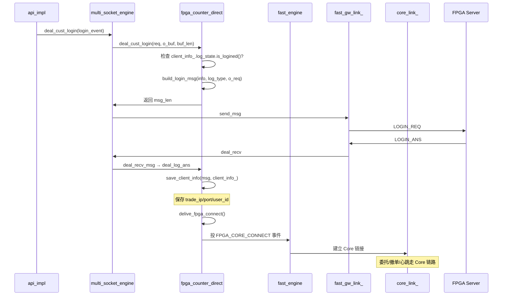
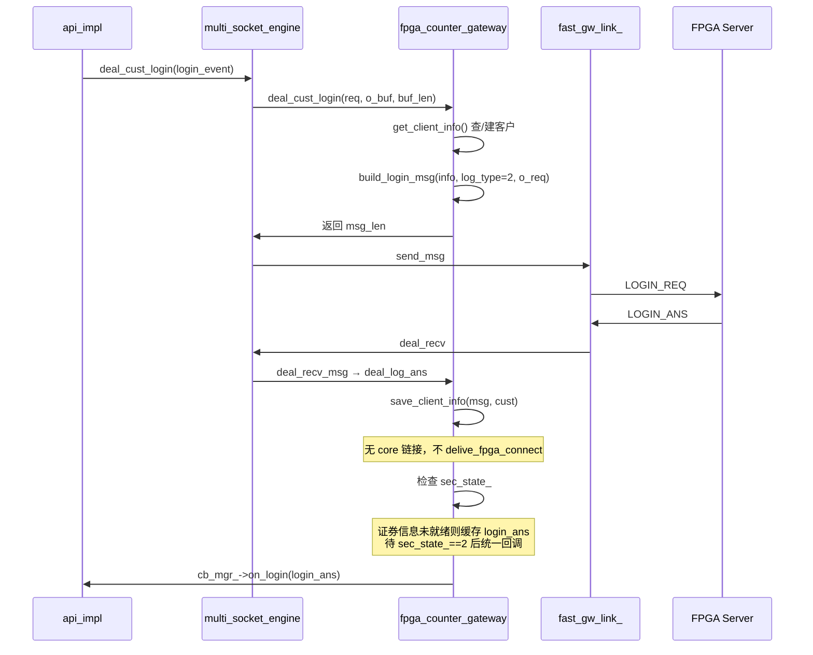
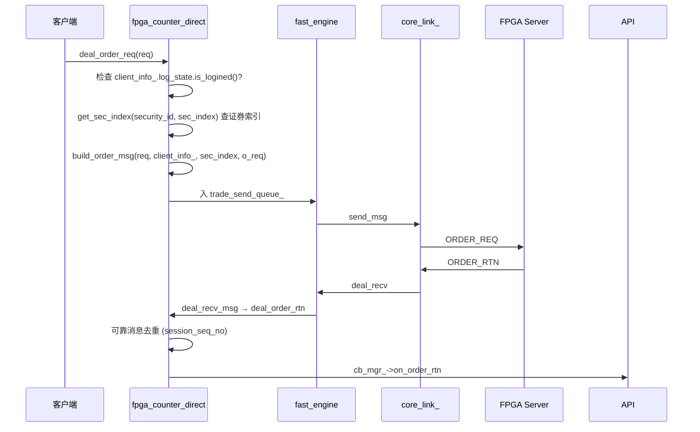
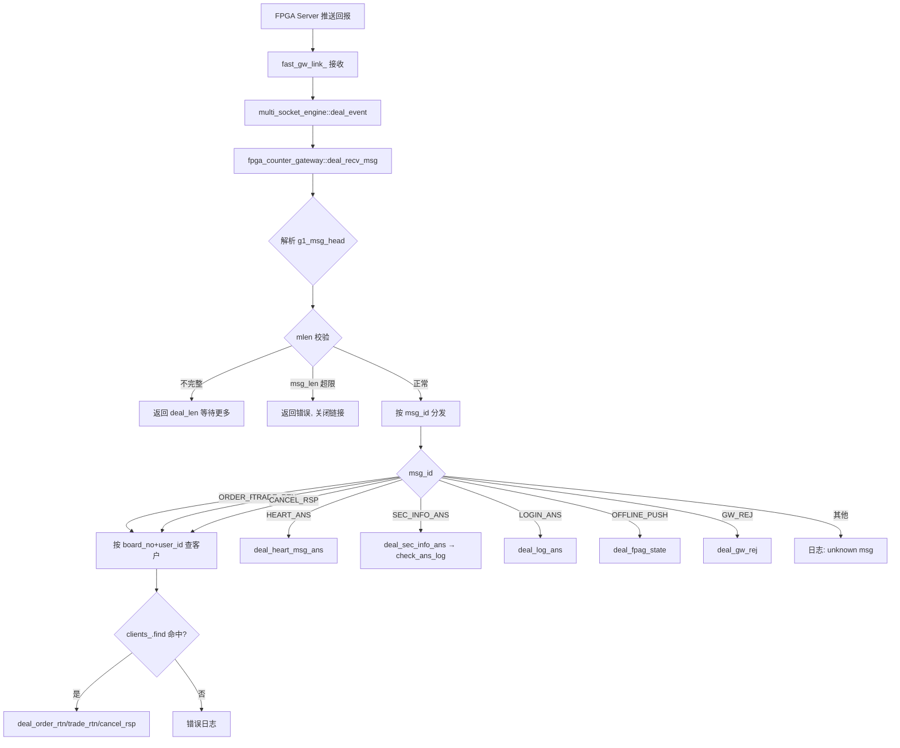
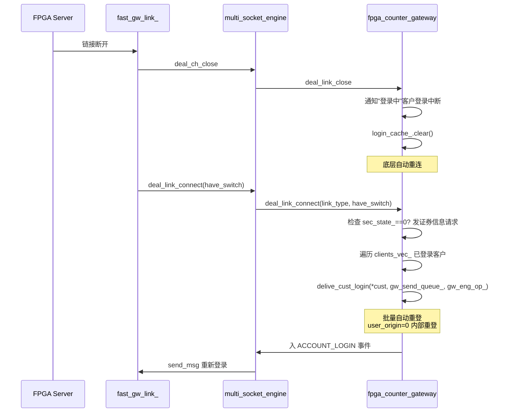
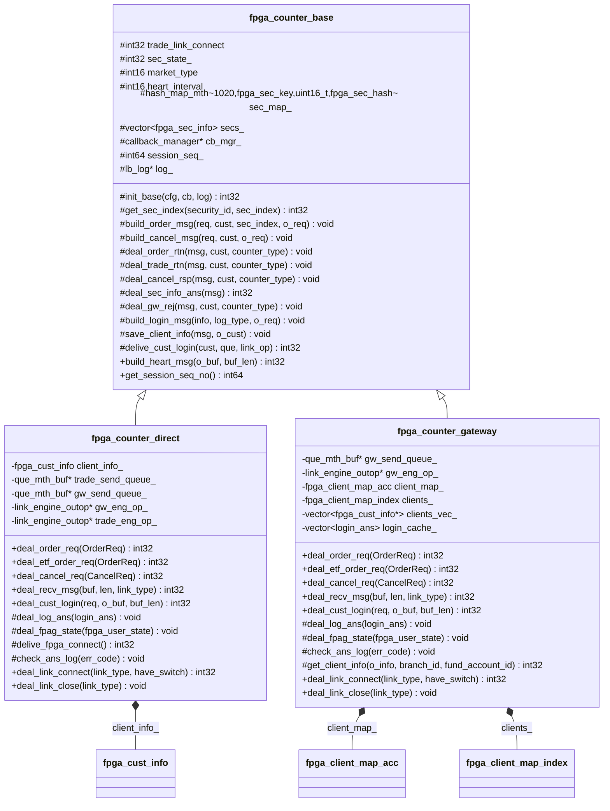
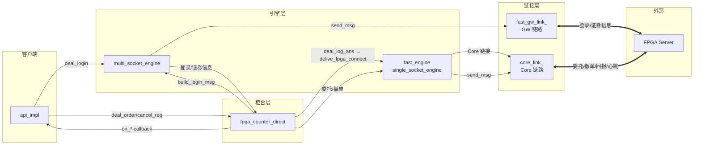
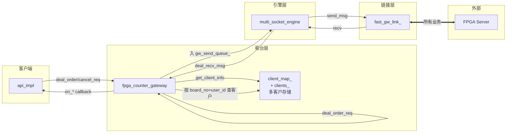

# FPGA 柜台（GOne）深入分析

> 源文件：`src/fpga_counter_base.h/.cpp` + `src/fpga_counter_direct.h/.cpp` + `src/fpga_counter_gateway.h/.cpp`
> 协议：G1 协议（`g1msghead.h` + `g1trademsg.h`）
> 设计文档：`doc/fpga_counter_base.md` + `doc/fpga_counter_direct.md` + `doc/fpga_counter_gateway.md`

---

## 1. 概述

**FPGA 柜台** 对接 GOne 硬件极速柜台系统，是框架中延迟最低、完成度最高的柜台。由三个类组成：

| 类 | 模式 | 客户数 | 链接 | 说明 |
|----|------|--------|------|------|
| `fpga_counter_base` | 公共基类 | - | - | 公共协议状态、证券映射、消息构建/解析 |
| `fpga_counter_direct` | 直连模式 | 单客户 | 双链路（GW + Core） | 委托/撤单走 Core 链路，登录/证券信息走 GW 链路 |
| `fpga_counter_gateway` | 网关模式 | 多客户 | 单链路（GW） | 所有业务走同一条 fpga_gw 链接 |

### 1.1 协议特征

| 特性 | 说明 |
|------|------|
| 协议 | G1 协议（`g1_msg_head` 头 + 业务体） |
| 报文格式 | `[g1_msg_head | 消息体]` |
| 消息头 | `g1_msg_head`（msg_id + msg_len + user_id + board_no + session_id） |
| 消息类型 | G1_MSG_LOGIN_REQ / G1_MSG_ORDER_REQ / G1_MSG_CANCEL_REQ / G1_MSG_SEC_INFO_REQ / G1_MSG_ORDER_RTN / G1_MSG_TRADE_RTN / G1_MSG_CANCEL_RSP / G1_MSG_HEART_ANS / G1_MSG_LOGIN_ANS / G1_MSG_SEC_INFO_ANS / G1_MSG_OFFLINE_PUSH / G1_MSG_GW_REJ |
| 多态 | **模板特化**（无 virtual 钩子），派生类显式调用基类 protected 方法 |

### 1.2 多态实现（关键设计）

```
fpga_counter_base（公共基类）
    ▲                    ▲
    │ 继承               │ 继承
fpga_counter_direct    fpga_counter_gateway
（直连，单客户）          （网关，多客户）
```

**重要**：多态通过**模板特化**实现，无 virtual 钩子。派生类的 `deal_recv_msg` 必须**显式调用**基类的 protected 方法。派生类的方法不是"override"，是派生类独有（同名方法被设计用于"显式调用"约定）。

---

## 2. 类结构

### 2.1 fpga_counter_base（公共基类）

#### 公共结构体

```cpp
// FPGA 客户信息（热路径字段在前，提升缓存命中）
struct fpga_cust_info {
  // 热路径：每次委托/撤单必用
  int32_t fpga_state;          // 该客户在 fpga 中状态
  log_state_ctl log_state;     // 登录状态机 (NONE/LOGOUT/OK + PENDING_USER/RELOGIN)
  uint16_t user_id;            // 用户索引ID(登录后分配)
  uint16_t board_no;           // 所在 FPGA 编号(登录后分配)
  uint32_t session_id;         // fdm board 映射的会话 ID
  char order_way_ext[2];       // 客户委托方式
  int32_t trade_port;          // 交易接口端口(登录后分配)
  char trade_ip[G1_IPADDR_LEN];// 交易接口地址IP(登录后分配)
  // 冷路径：仅登录/管理使用
  char cust_id[G1_CUSTID_LEN];
  char fund_account_id[G1_FUNDACCOUNTID_LEN];
  char branch_id[G1_BRANCHID_LEN];
  char holder_acc[G1_HOLDERACC_LEN];
  int64_t cust_req_no;
  char end_code[G1_CUST_END_LEN];
};

// 证券信息
struct fpga_sec_info {
  char security_id[G1_SECURITYID_MAXLEN]; // 证券代码
  int16_t market_type;                    // 市场
  uint16_t sec_index;                     // 证券在 FPGA 内的索引
  int32_t buy_qty_unit;                   // 买数量单位
};
```

#### 核心成员

```cpp
class fpga_counter_base {
  // ---- 公共协议状态 ----
  int32 trade_link_connect = 0;  // 交易通道是否链接
  int32 sec_state_ = 0;          // 证券信息获取状态: 0-未进行, 1-进行中, 2-成功
  int16 market_type = 0;
  int16 heart_interval = 5;

  // ---- 证券代码映射 ----
  hash_map_mth<1020, fpga_sec_key, uint16_t, fpga_sec_hash> sec_map_; // 证券代码→sec_index
  std::vector<fpga_sec_info> secs_;  // 证券信息数组（按 sec_index 索引）

  // ---- 回调/日志/会话 ----
  callback_manager *cb_mgr_;
  int64 session_seq_;            // 会话消息序号（原子访问）
  lb_log *log_;
  char agw_user[32];
};
```

### 2.2 fpga_counter_direct（直连模式，单客户）

```cpp
class fpga_counter_direct : public fpga_counter_base {
  // 唯一额外存储：单一客户
  fpga_cust_info client_info_{};
  que_mth_buf *trade_send_queue_;  // 极速柜台发送队列（Core 链路）
  que_mth_buf *gw_send_queue_;     // GW 链接发送队列
  link_engine_outop *gw_eng_op_;
  link_engine_outop *trade_eng_op_;
};
```

**关键**：GW 登录成功后才可建立 fpga trade 链接（trade_ip/port 由 GW 登录应答回填到 `client_info_`）。

### 2.3 fpga_counter_gateway（网关模式，多客户）

```cpp
class fpga_counter_gateway : public fpga_counter_base {
  // 多客户存储
  fpga_client_map_acc client_map_;  // 资金账号+分支机构 → user_id+board_no（发送查询用）
  fpga_client_map_index clients_;   // boardno+userid → fpga_cust_info*（接收查询用）
  std::vector<fpga_cust_info*> clients_vec_;  // 仅用于回收
  std::vector<login_ans> login_cache_;        // 缓存登录成功但证券信息未就绪的 login_ans

  que_mth_buf *gw_send_queue_;  // GW 链接发送队列（唯一业务队列）
  link_engine_outop *gw_eng_op_;
};
```

#### 多客户 hash 键

```cpp
struct fpga_fundacc_key {
  char fund_account_id[16];  // 客户资金账号
  char branch_id[16];        // 分支机构代码（协议 BRANCHID_LEN=12，此处对齐到 16）
  // 按 64-bit 块复制/比较，避免逐字节
};

struct fpga_fundacc_index {
  uint16 board_no;
  uint16 user_id;
  // 复合键：boardno + user_id → fpga_cust_info*
};
```

---

## 3. 核心流程

### 3.1 登录流程（direct 模式）



### 3.2 登录流程（gateway 模式）



**direct vs gateway 登录差异**：

| 维度 | direct | gateway |
|------|--------|---------|
| 登录类型 | log_type 由调用方指定 | log_type=2（网关代多客户登录） |
| Core 链接 | 登录成功后建立 Core 链接 | 无 Core 链接 |
| 客户存储 | 单客户 `client_info_` | 多客户 `client_map_` + `clients_` |
| login_ans 回调 | 证券信息就绪后直接回调 | 证券信息未就绪先缓存，就绪后统一回调 |

### 3.3 委托发送（direct 模式）



### 3.4 回报接收与分发（gateway 模式）



### 3.5 断链重登（gateway 模式）



---

## 4. 开发注意事项

### 4.1 模板特化多态（无 virtual）

```cpp
// ❌ 不要期望虚函数分发
// ✅ 派生类 deal_recv_msg 中显式调用基类方法
int32 fpga_counter_direct::deal_recv_msg(...) {
  case G1_MSG_ORDER_RTN:
    deal_order_rtn(head, client_info_, counter_type::fpga_direct);  // 显式调用基类
    break;
}
```

**关键**：派生类的 `deal_recv_msg` 必须逐个 case 显式调用基类的 `deal_order_rtn`/`deal_trade_rtn`/`deal_cancel_rsp`/`deal_sec_info_ans` 等 protected 方法，并传入正确的 `counter_type` 和客户信息。

### 4.2 热路径/冷路径分离

`fpga_cust_info` 中委托/撤单必用的字段（fpga_state / user_id / board_no / session_id / trade_port / trade_ip）放在结构体前面，冷路径字段（cust_id / fund_account_id / branch_id 等）放后面，提升缓存命中率。

### 4.3 可靠消息去重

```cpp
// deal_order_rtn 中：依据 body.session_seq_no 做可靠消息去重
const order_rtn *rtn = reinterpret_cast<const order_rtn *>(msg + 1);
if (rtn->session_seq_no > 0) {
  if (unlikely(rtn->session_seq_no <= session_seq_)) {
    return;  // 重复消息，丢弃
  }
  session_seq_ = rtn->session_seq_no;
}
```

> `session_seq_no > 0` 表示可靠消息，`0` 表示非可靠消息不参与去重。

### 4.4 证券代码映射

```cpp
// 证券代码 → sec_index 的 O(1) 查询
int32 fpga_counter_base::get_sec_index(const char security_id[8], uint16_t &sec_index) {
  fpga_sec_key key(security_id);
  int32 ret = sec_map_.find(sec_index, key);
  if (unlikely(ret < 0)) return LBAPI_ERR_NO_SEC;
  return 0;
}
```

`sec_map_` 用 `hash_map_mth<1020, fpga_sec_key, uint16_t, fpga_sec_hash>` 实现，`fpga_sec_key` 按 64-bit 块复制/比较，避免逐字节。证券信息由 G1_MSG_SEC_INFO_ANS 应答填充（`deal_sec_info_ans`）。

### 4.5 多客户查找（gateway）

```cpp
// 接收回报：按 (board_no, user_id) 复合键查客户
// 多板卡 user_id 各自从 1 开始，故必须用复合键
const order_rtn *body = reinterpret_cast<const order_rtn *>(head + 1);
fpga_fundacc_index idx(body->board_no, body->user_id);
fpga_cust_info *cust = nullptr;
if (clients_.find(cust, idx, 1) == 0 && cust != nullptr) {
  deal_order_rtn(head, *cust, counter_type::fpga_gateway);
}
```

### 4.6 未知消息处理

```cpp
default: {
  // 未知消息，跳过，不返回错误，以避免链接关闭
  // 保证旧 api 对新增消息的兼容性
  info_log(tlh) << "fpga counter recv unknown msg, msg_id=" << head->msg_id << end_log;
  break;
}
```

**注意**：未知消息不返回错误，避免链接关闭，保证向前兼容。

### 4.7 待完善项

1. **地址切换重登**（todo）：`deal_link_connect` 中"链接地址切换是否重新登录"待确认
2. **check_order_dict**：委托状态字典映射待完善（`// todo : 依据委托状态字典变动而修改`）
3. **回报类型字典**：`build_api_order_rej` 中 `// todo : 依据回报类型字典变动而修改`

---

## 5. 类图



---

## 6. 数据流总览

### 6.1 direct 模式（双链路）



### 6.2 gateway 模式（单链路）



---

## 7. 编译与测试

- **编译**：`cd gone/api && env -u LD_LIBRARY_PATH /usr/bin/cmake .. && make`
- **GOne 回归**：功能 5/5 PASS，性能 90053/90053 0 失败
- **性能**：GOne（P50=242ns，干净环境 avg=2159ns）中低延迟全面优于 FTE，P50→P95 仅 245→304ns（跨度 59ns），几乎无尾部延迟，体现 fpga_direct 硬件极速优势
- **双链路验证**：`connection_config_gone.json`（fast_counter_type=2, speed_link_type=1），GW=44001 / Core=44002