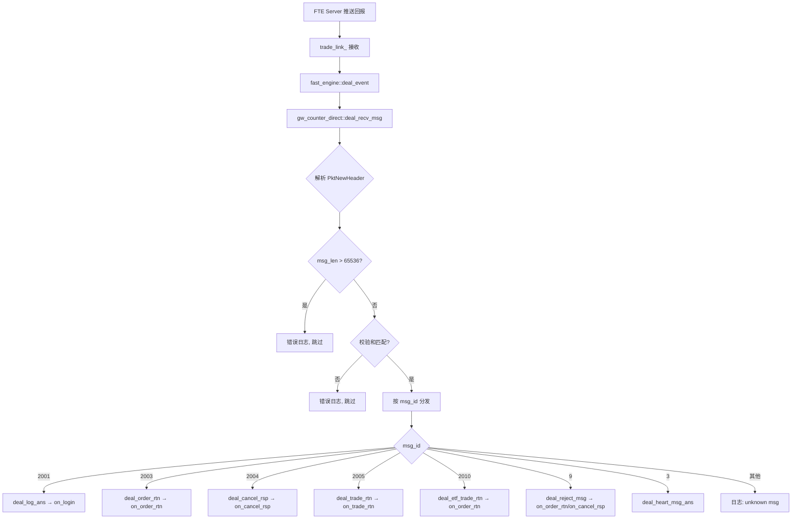
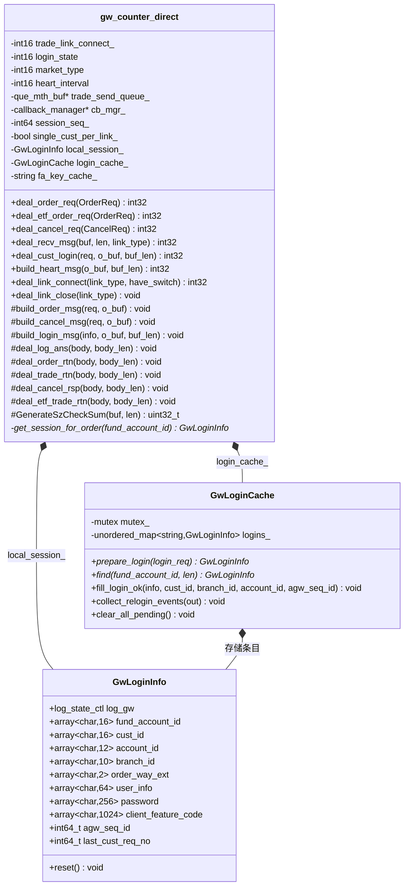
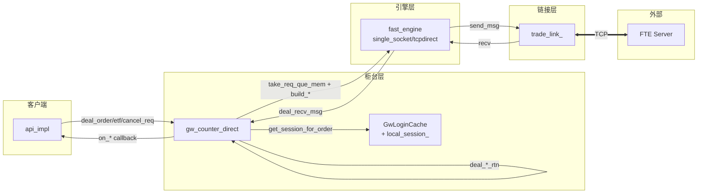

# 个微柜台（gw_counter_direct）深入分析

> 源文件：`src/gw_counter_direct.h` + `src/gw_counter_direct.cpp`
> 缓存类：`src/gw_login_cache.h`
> 协议：FTE TCP Binary（`gw_message::*` 结构体）
> 设计文档：`doc/gw_counter_direct.md`

---

## 1. 概述

**gw_counter_direct** 是个微软件极速柜台（直连模式）协议对象，对接 FTE（Fast Trading Engine）系统。在整个 NewAPI 框架中承担软件加速柜台角色。

### 1.1 角色定位

| 特性 | 说明 |
|------|------|
| 柜台类型 | `counter_type::gw_direct`（软件极速） |
| 协议 | FTE TCP Binary（`gw_message::*` 结构体，大端字节序） |
| 报文格式 | `[PktNewHeader 8B \| 消息体 \| 校验和 4B]` |
| 链接 | 单 TCP 链接（`LINK_TYPE_SPEED_TRADE`） |
| 查询接口 | **无**（与 fpga_counter_gateway 一致） |
| 降级策略 | 离线/不支持时返回错误码，上层路由到 98 |
| 性能优化 | 直接序列化 + 单趟校验和 + 原子化状态 + 日志降噪 |

### 1.2 协议消息类型

| 方向 | msg_id | 消息体结构 | 说明 |
|------|--------|-----------|------|
| 上行 | 1001 | `LogOnReq` | 账户登录 |
| 上行 | 1003 | `TradeOrderReq` | 买卖委托 |
| 上行 | 1004 | `CancelOrderReq` | 撤单 |
| 上行 | 1010 | `TradeOrderReq` | ETF 申购赎回 |
| 上行 | 3 | - | 心跳（仅头+校验和） |
| 下行 | 2001 | `LogOnAns` | 登录应答 |
| 下行 | 2003 | `TradeOrderER` | 委托回报 |
| 下行 | 2004 | `TradeOrderER` | 撤单应答 |
| 下行 | 2005 | `TradeOrderER` | 成交回报 |
| 下行 | 2010 | `TradeOrderER` + 成分股数组 | ETF 成交回报 |
| 下行 | 9 | `RejectMsg` | 拒绝消息 |

### 1.3 字节序注意

- **消息头** `PktNewHeader`：`msg_id`/`msg_len` 用 `ByteSwap32` 显式大端交换
- **消息体**：使用**主机字节序**（`HostToNetwork` 当前为 no-op）
- **校验和**：`GenerateSzCheckSum` 对 [头+体] 求和 %256，`ByteSwap32` 后追加

---

## 2. 类结构

### 2.1 核心成员

```cpp
class gw_counter_direct {
  // ---- 链接与登录状态（跨线程，原子访问） ----
  int16 trade_link_connect_ = 0;  // 极速链接状态（atomic_load16/store16）
  int16 login_state = 0;          // 用户登录状态: 0-未登录, 1-登录中, 2-登录成功
  int16 market_type = 0;          // 市场
  int16 heart_interval = 5;       // 心跳间隔

  // ---- 队列与引擎操作 ----
  que_mth_buf *trade_send_queue_; // 极速柜台发送队列
  link_engine_outop *trade_eng_op_;

  // ---- 回调与日志 ----
  callback_manager *cb_mgr_;
  int64 session_seq_ = 0;         // 会话消息序号（atomic_fetch_add64/load64）
  lb_log *log_;

  // ---- 账户缓存（实例缓存，非全局单例） ----
  bool single_cust_per_link_ = true;  // 单链接单客户模式（默认 true）
  GwLoginInfo local_session_;         // 单客户模式本地会话（不走 map）
  GwLoginCache login_cache_;          // 多客户模式登录缓存（fund_account_id 主键）
  std::string fa_key_cache_;          // 键缓存（避免每次构造 std::string）
};
```

### 2.2 GwLoginCache（账户登录缓存）

```cpp
class GwLoginCache {
  // 以 fund_account_id 为 key 的实例缓存（gw_counter_direct 成员）
  std::unordered_map<std::string, GwLoginInfo> logins_;
  std::mutex mutex_;

  // 核心方法
  GwLoginInfo* prepare_login(const acc_login_event_info &login_req);  // 凭据暂存
  GwLoginInfo* find(const char *fund_account_id, size_t len);         // 查找
  void fill_login_ok(info, cust_id, branch_id, account_id, agw_seq_id); // 登录成功回填
  void collect_relogin_events(vector<acc_login_event_info> &out);     // 断链重登收集
  void clear_all_pending();  // 断链：仅清在途
};
```

### 2.3 GwLoginInfo（登录信息结构体）

```cpp
struct GwLoginInfo {
  log_state_ctl log_gw;              // 个微登录控制状态机（原子，状态+在途）
  array<char,16> fund_account_id;    // 资金账号（主键）
  array<char,16> cust_id;            // 客户号（登录应答回填）
  array<char,12> account_id;         // 股东账户（登录应答回填）
  array<char,10> branch_id;          // 分支机构代码
  array<char,2> order_way_ext;       // 客户委托方式
  array<char,64> user_info;          // 用户私有信息（重登组包用）
  array<char,256> password;          // 密码（重登组包用）
  array<char,1024> client_feature_code; // 终端信息（重登组包用）
  int64_t agw_seq_id = 0;            // 个微会话序号
  int64_t last_cust_req_no = 0;      // 最近一次登录请求号
};
```

> **注意**：`order_locators` 原单定位映射已移除（撤单优化），`GwLoginInfo` 不再包含该成员。

---

## 3. 核心流程

### 3.1 会话查找（单客户/多客户模式分流）

```cpp
GwLoginInfo *gw_counter_direct::get_session_for_order(const char *fund_account_id) {
  if (single_cust_per_link_) {
    return &local_session_;           // 单客户：直接返回本地成员，无锁
  }
  fa_key_cache_.assign(fund_account_id, strnlen(fund_account_id, 16));
  return login_cache_.find(fa_key_cache_.data(), fa_key_cache_.size());  // 多客户：查 map
}
```

**单客户模式**（`single_cust_per_link_=true`，默认）：登录成功后直接缓存到 `local_session_`（`GwLoginInfo` 本地成员），委托/撤单组包时直接读取，**无锁、无哈希、无 string 构造**。

### 3.2 账户登录

```mermaid
sequenceDiagram
    participant API as api_impl
    participant GW as gw_counter_direct
    participant Engine as fast_engine
    participant Link as trade_link_
    participant FTE as FTE Server

    API->>Engine: deal_cust_login(login_event)
    Engine->>GW: deal_cust_login(req, o_buf, buf_len)
    GW->>GW: 检查 login_state==2? 已登录则返回0
    GW->>GW: build_login_msg(info, o_buf) 组包
    Note over GW: PktNewHeader + LogOnReq + 校验和
    GW->>Engine: 返回 msg_len
    Engine->>Link: send_msg
    Link->>FTE: LogOnReq (1001)
    FTE->>Link: LogOnAns (2001)
    Link->>Engine: deal_recv
    Engine->>GW: deal_recv_msg → deal_log_ans
    GW->>GW: 解码 LogOnAns
    GW->>GW: 回填会话（单客户→local_session_ / 多客户→login_cache_）
    GW->>GW: atomic_store16(&login_state, 2)
    GW->>GW: build_login_rtn(ans, login_ans)
    GW->>API: cb_mgr_->on_login(login_ans)
```

**登录成功回报时缓存**：`deal_log_ans` 中回填 cust_id/branch_id/account_id/agw_seq_id。值不变不写（RUL-15）维持发布屏障。

### 3.3 委托发送（性能优化路径）

```mermaid
sequenceDiagram
    participant Client as 客户端
    participant GW as gw_counter_direct
    participant Engine as fast_engine
    participant Link as trade_link_
    participant FTE as FTE Server

    Client->>GW: deal_order_req(req)
    GW->>GW: 前置校验 (link_connect_ && login_state==2)
    GW->>GW: take_req_que_mem(data, 118) 预留队列内存
    Note over GW: FTE 报文定长 118B
    GW->>GW: build_order_msg(req, data+sizeof)
    Note over GW: 直接序列化 + 单趟校验和<br/>cksum_copy_pad / cksum_net64 等
    GW->>GW: evt->leave_time_ptr = &req.api_leave_time_ns
    GW->>GW: cmt_req_que_mem(pos, 118) 提交
    Engine->>Link: send_msg
    Link->>FTE: TradeOrderReq (1003)
    GW-->>Client: 返回 LBAPI_OK
```

**性能优化要点**：
- **定长消息**：FTE 报文长度固定（委托 118B / 撤单 78B / ETF 118B），`take_len == msg_len`，无变长消息的"预留/提交"一致性问题
- **直接序列化**：无中间 body 对象，直接在 `o_buf` 按字段顺序序列化（方案 D）
- **单趟校验和**：边写边累加，消除第二次 O(n) 遍历（方案 C）
- **cksum_copy_pad**：一次遍历完成"拷贝 + 空格填充 + 校验和累加"（方案 B）

### 3.4 回报接收与分发



### 3.5 撤单优化（消除 order_locators 缓存）

```mermaid
flowchart LR
    subgraph 优化前
        A1[委托回报] -->|record_order_locator<br/>order_id→{clordno,client_seq_id}| A2[order_locators 缓存]
        A3[撤单请求] -->|get_clordno/get_orig_client_seq_id<br/>3次全局锁| A2
    end
    subgraph 优化后
        B1[委托回报] -->|rtn.order_sys_no = er.clordno| B3[直接返回 clordno]
        B2[撤单请求] -->|orig_clordno = req.order_sys_no| B3
    end
```

**关键变更**：
- `deal_order_rtn` / `deal_etf_trade_rtn`：`rtn.order_sys_no = er.clordno`（替代 strtoll(er.order_id)）
- `deal_trade_rtn`：移除 `record_order_locator` 调用（成交回报不参与撤单）
- `build_cancel_msg`：`orig_clordno = req.order_sys_no`，`orig_client_seq_id = 0`
- **字段顺序**：`orig_client_seq_id` 在前（8B）、`orig_clordno` 在后（8B），与 `gw_head.h` 中 `CancelOrderReq` 结构体一致

---

## 4. 开发注意事项

### 4.1 原子化状态访问（方案 F）

跨线程状态变量统一用 `matomic.h` 的原子操作：

```cpp
// 读
lb_common::atomic_load16(&trade_link_connect_)
lb_common::atomic_load16(&login_state)

// 写
lb_common::atomic_store16(&trade_link_connect_, 1);
lb_common::atomic_store16(&login_state, 2);

// 会话序号
lb_common::atomic_fetch_add64(&session_seq_, 1) + 1
lb_common::atomic_load64(&session_seq_)
```

### 4.2 单客户 vs 多客户模式

| 维度 | 单客户模式（默认） | 多客户模式 |
|------|------------------|-----------|
| 会话存储 | `local_session_` 本地成员 | `login_cache_`（GwLoginCache） |
| 查找开销 | 直接读取，无锁 | `mutex` + `unordered_map` 哈希 + `string` 构造 |
| 适用场景 | 单 API 实例单客户 | 单链接多客户 |
| 配置项 | `single_cust_per_link=true` | `single_cust_per_link=false` |

### 4.3 日志降噪（方案 E）

高频日志已降级为 `debug_log`（生产可关闭）：
- `deal_recv_msg` 每笔回报日志（含 hexbuf 构造）
- `deal_trade_rtn` 入口日志

### 4.4 链接生命周期

```cpp
// deal_link_connect: 链接建立
int32 gw_counter_direct::deal_link_connect(int16 link_type, int32 have_switch) {
  (void)have_switch;  // 个微不支持地址切换
  atomic_store16(&trade_link_connect_, 1);
  cb_mgr_->on_link_status(1, 0, 1);
  return 0;
}

// deal_link_close: 链接关闭
void gw_counter_direct::deal_link_close(int16 link_type) {
  atomic_store16(&trade_link_connect_, 0);
  atomic_store16(&login_state, 0);
  login_cache_.clear_all_pending();  // 清在途，保留登录状态
  cb_mgr_->on_link_status(1, 0, 0);
}
```

### 4.5 待完善项

1. **断线自动重登**：`GwLoginCache::collect_relogin_events()` 已实现多客户批量重登，但单客户模式触发接入待完善
2. **登录异常重试**：登录失败后重试机制未实现
3. **deal_send_error**：发送失败处理逻辑待完善

---

## 5. 类图



---

## 6. 数据流总览



---

## 7. 编译与测试

- **编译**：`cd gone/api && env -u LD_LIBRARY_PATH /usr/bin/cmake .. && make`
- **GOne 回归**：功能 5/5 PASS，性能 90053/90053 0 失败
- **GW(FTE) 回归**：功能 5/5 PASS（撤单 err_code=50046 符合预期）
- **性能对比**：GOne（P50=242ns）全面优于 FTE（P50=419ns），FTE 尾部延迟（P95=2850ns）是 GOne（P95=304ns）的 9.4 倍