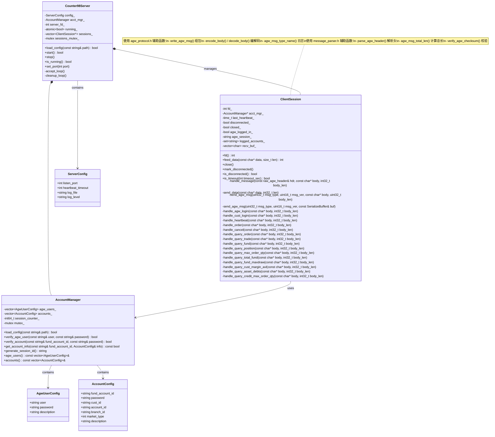
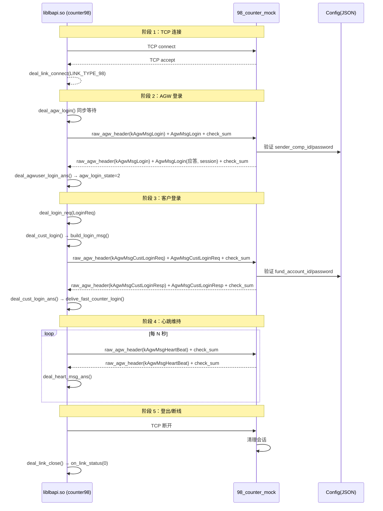
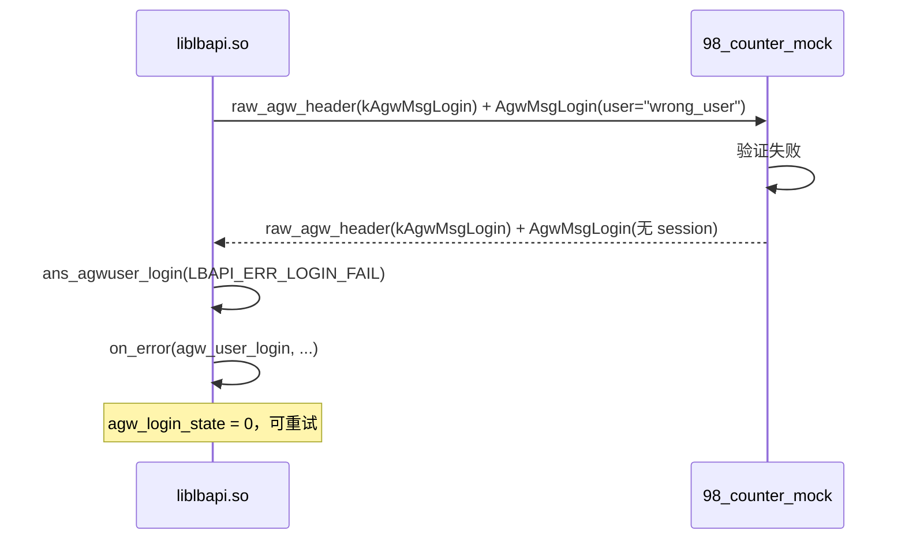
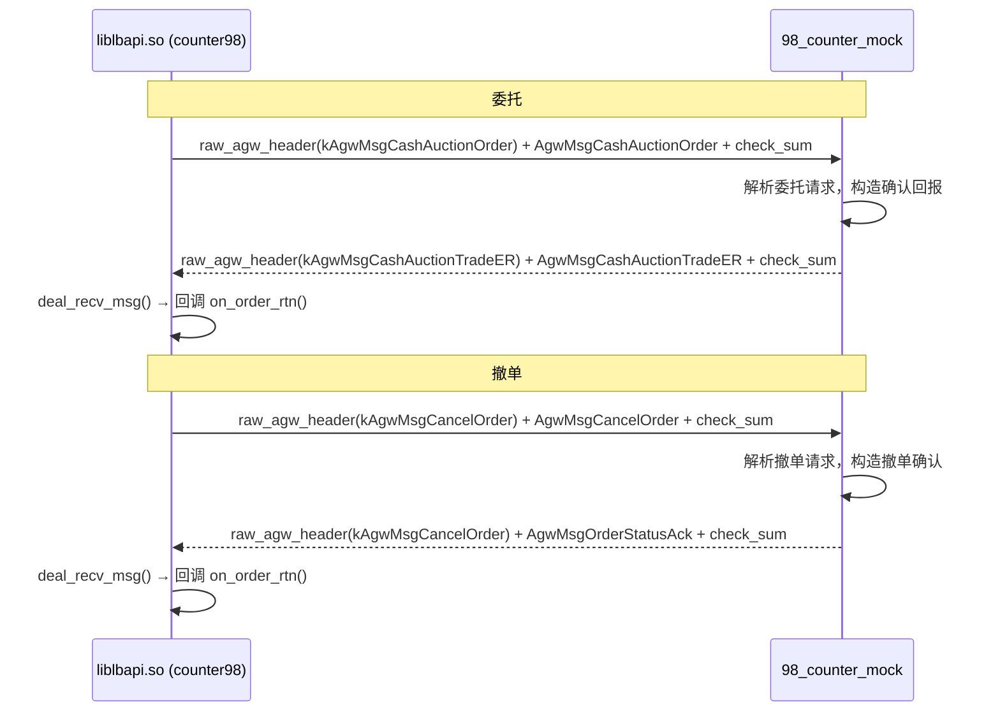
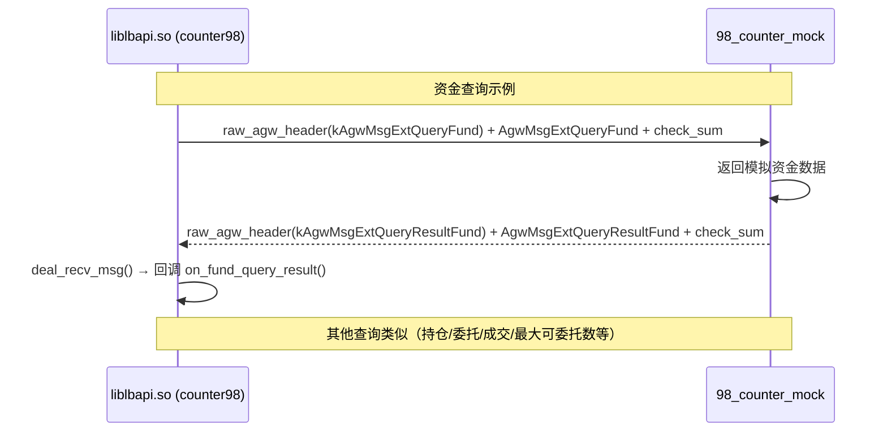
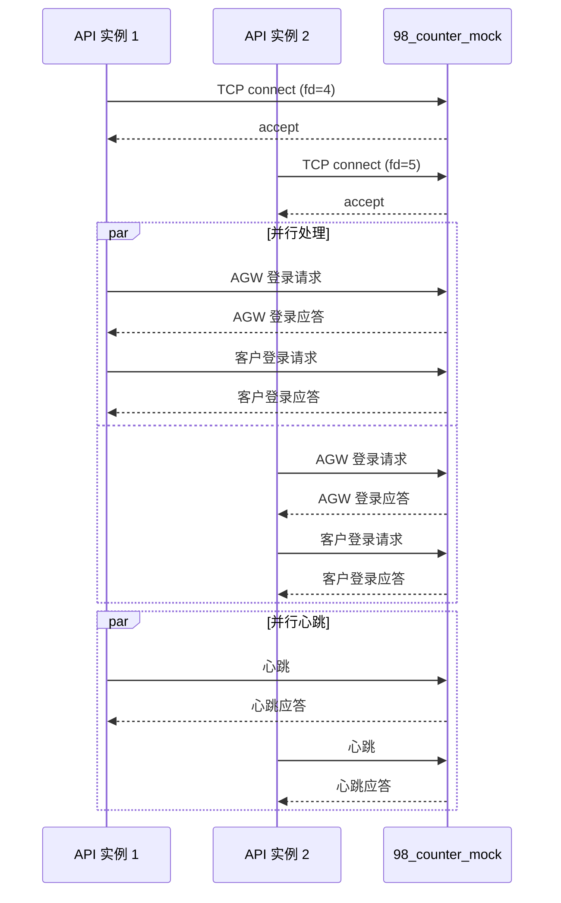

# 98_counter_mock 设计文档

> **目的**：模拟 98 柜台服务端，为 API 的 98_counter 模块提供连接、登录、心跳、委托、撤单、查询等全功能测试支持。
> **输出目录**：`mock/98_counter/`
> **参考协议**：`lb_counter98_protocol.h`（Archforce AGW 协议，位于 `gone/counter98/`）
> **参考实现**：`counter98.h` / `counter98.cpp`
> **协议源文件**：`gone/counter98/` 目录下的 AGW 协议编解码源文件

---

## 目录

1. [模块定位与架构](#1-模块定位与架构)
2. [AGW 协议分析](#2-agw-协议分析)
3. [API 98_counter 模块考察](#3-api-98_counter-模块考察)
4. [功能清单](#4-功能清单)
5. [UML 类图](#5-uml-类图)
6. [时序图](#6-时序图)
7. [项目文件结构](#7-项目文件结构)
8. [CMakeLists.txt 构建方案](#8-cmakeliststxt-构建方案)
9. [配置说明](#9-配置说明)
10. [API 98_counter 模块完善建议](#10-api-98_counter-模块完善建议)

---

## 1. 模块定位与架构

### 1.1 在整体测试架构中的位置

```
┌──────────────────────────────────────────────────────────────┐
│                    API 测试环境                                │
├──────────────────────────────────────────────────────────────┤
│                                                              │
│  ┌──────────────────┐     ┌──────────────────────────────┐  │
│  │  mock_client     │────→│  liblbapi.so (被测 API)      │  │
│  │  (测试驱动)       │     │  ┌───────────────────────┐  │  │
│  └──────────────────┘     │  │ counter98 模块         │  │  │
│                           │  │ (AGW 协议处理)         │  │  │
│                           │  └───────────┬───────────┘  │  │
│                           └──────────────┼──────────────┘  │
│                                          │                  │
│                                          ▼                  │
│                           ┌──────────────────────────────┐  │
│                           │  98_counter_mock (本组件)     │  │
│                           │  ┌───────────────────────┐  │  │
│                           │  │ TCP Server            │  │  │
│                           │  │ (AGW 登录 + 账户登录   │  │  │
│                           │  │  + 心跳 + 委托/撤单    │  │  │
│                           │  │  + 各类查询)           │  │  │
│                           │  └───────────────────────┘  │  │
│                           └──────────────────────────────┘  │
│                                                              │
└──────────────────────────────────────────────────────────────┘
```

### 1.2 与 API 98_counter 模块的交互

```
counter98 (API 侧)
    │
    │ ① deal_agw_login() → build_agw_login_msg()
    │    ── TCP send ──→ raw_agw_header(kAgwMsgLogin) + AgwMsgLogin(编码体) + check_sum
    │
    │ ② ←── TCP recv ── raw_agw_header(kAgwMsgLogin) + AgwMsgLogin(应答体) + check_sum
    │    deal_agwuser_login_ans()
    │
    │ ③ deal_login_req() → build_cust_login_event() → LINK_EVENT_TYPE_ACCOUNT_LOGIN
    │    ── TCP send ──→ raw_agw_header(kAgwMsgCustLoginReq) + AgwMsgCustLoginReq(编码体) + check_sum
    │
    │ ④ ←── TCP recv ── raw_agw_header(kAgwMsgCustLoginResp) + AgwMsgCustLoginResp(应答体) + check_sum
    │    deal_cust_login_ans()
    │
    │ ⑤ build_heart_msg()
    │    ── TCP send ──→ raw_agw_header(kAgwMsgHeartBeat) + check_sum
    │
    │ ⑥ ←── TCP recv ── raw_agw_header(kAgwMsgHeartBeat) + check_sum
    │    deal_heart_msg_ans()
    │
    │ ⑦ build_order_msg() → 委托
    │    ── TCP send ──→ raw_agw_header(kAgwMsgCashAuctionOrder) + AgwMsgCashAuctionOrder + check_sum
    │    ←── TCP recv ── raw_agw_header(kAgwMsgCashAuctionTradeER) + AgwMsgCashAuctionTradeER + check_sum
    │
    │ ⑧ build_cancel_msg() → 撤单
    │    ── TCP send ──→ raw_agw_header(kAgwMsgCancelOrder) + AgwMsgCancelOrder + check_sum
    │    ←── TCP recv ── raw_agw_header(kAgwMsgCancelOrder) + AgwMsgOrderStatusAck + check_sum
    │
    │ ⑨ 各类查询（资金/持仓/委托/成交/最大可委托数等）
    │    ── TCP send ──→ raw_agw_header(kAgwMsgExtQuery*) + 查询请求体 + check_sum
    │    ←── TCP recv ── raw_agw_header(kAgwMsgExtQueryResult*) + 查询结果体 + check_sum
    │
    ▼
98_counter_mock (本组件)
```

---

## 2. AGW 协议分析

### 2.1 报文格式

Mock 使用 Archforce AGW 协议（与 API 侧 `counter98.cpp` 完全一致），线格式如下：

```
┌──────────────────────┬──────────────────────┬──────────────────┐
│ raw_agw_header 16B   │ Body (变长)           │ CheckSum 4B      │
│ msg_type(4) |        │ (MessageEncoder 编码) │ (网络字节序)      │
│ msg_ver(2)  |        │                      │                  │
│ reserver(2) |        │                      │                  │
│ seq_num(4)  |        │                      │                  │
│ body_length(4)       │                      │                  │
└──────────────────────┴──────────────────────┴──────────────────┘
whole_msg_len = sizeof(raw_agw_header) + body_length + sizeof(uint32_t)
```

**关键说明**：
- `body_length` 仅含 Body 长度，不含 Header 和 CheckSum
- CheckSum 覆盖 Header + Body，逐字节累加后 `% 256`，以 4 字节网络字节序传输
- Body 使用 `lb_counter98::MessageEncoder` / `MessageDecoder` 进行编解码
- `raw_agw_header` 定义在 `agw_protocol.h` 中，与 `gone/counter98/` 协议层共用

### 2.2 消息类型定义

消息类型常量定义在 `lb_counter98_protocol.h`（re-export 自 `constants_agw_external.h`）：

#### 2.2.1 登录 / 心跳

| 常量 | 方向 | 消息体 | 说明 |
|------|------|--------|------|
| `lb_counter98::kAgwMsgLogin` | API→Mock / Mock→API | `AgwMsgLogin` | AGW 登录请求/应答（同消息类型双向使用） |
| `lb_counter98::kAgwMsgCustLoginReq` | API→Mock | `AgwMsgCustLoginReq` | 客户登录请求 |
| `lb_counter98::kAgwMsgCustLoginResp` | Mock→API | `AgwMsgCustLoginResp` | 客户登录应答 |
| `lb_counter98::kAgwMsgHeartBeat` | API→Mock / Mock→API | 无消息体 | 心跳请求/应答 |

#### 2.2.2 委托 / 撤单

| 常量 | 方向 | 消息体 | 说明 |
|------|------|--------|------|
| `lb_counter98::kAgwMsgCashAuctionOrder` | API→Mock | `AgwMsgCashAuctionOrder` | 普通竞价委托请求 |
| `lb_counter98::kAgwMsgCashAuctionTradeER` | Mock→API | `AgwMsgCashAuctionTradeER` | 委托成交回报 |
| `lb_counter98::kAgwMsgCancelOrder` | API→Mock | `AgwMsgCancelOrder` | 撤单请求 |
| `lb_counter98::kAgwMsgCancelOrder` | Mock→API | `AgwMsgOrderStatusAck` | 撤单应答（同消息类型，不同消息体） |

#### 2.2.3 查询

| 常量 | 方向 | 消息体 | 说明 |
|------|------|--------|------|
| `lb_counter98::kAgwMsgExtQueryOrder` | API→Mock | `AgwMsgExtQueryOrder` | 当日委托查询 |
| `lb_counter98::kAgwMsgExtQueryResultOrder` | Mock→API | `AgwMsgExtQueryResultOrder` | 委托查询结果 |
| `lb_counter98::kAgwMsgExtQueryTradeOrder` | API→Mock | `AgwMsgExtQueryTradeOrder` | 当日成交查询 |
| `lb_counter98::kAgwMsgExtQueryResultTradeOrder` | Mock→API | `AgwMsgExtQueryResultTradeOrder` | 成交查询结果 |
| `lb_counter98::kAgwMsgExtQueryFund` | API→Mock | `AgwMsgExtQueryFund` | 资金查询 |
| `lb_counter98::kAgwMsgExtQueryResultFund` | Mock→API | `AgwMsgExtQueryResultFund` | 资金查询结果 |
| `lb_counter98::kAgwMsgExtQuerySelfShare` | API→Mock | `AgwMsgExtQuerySelfShare` | 持仓查询 |
| `lb_counter98::kAgwMsgExtQueryResultSelfShare` | Mock→API | `AgwMsgExtQueryResultSelfShare` | 持仓查询结果 |
| `lb_counter98::kAgwMsgExtQueryMaxOrderQty` | API→Mock | `AgwMsgExtQueryMaxOrderQty` | 最大可委托数查询 |
| `lb_counter98::kAgwMsgExtQueryMaxOrderQtyResult` | Mock→API | `AgwMsgExtQueryMaxOrderQtyResult` | 最大可委托数查询结果 |
| `lb_counter98::kAgwMsgExternalQueryTotalFundAsset` | API→Mock | `AgwMsgExternalQueryTotalFundAsset` | 总资金资产查询 |
| `lb_counter98::kAgwMsgExtQueryResultTotalFundAsset` | Mock→API | `AgwMsgExtQueryResultTotalFundAsset` | 总资金资产查询结果 |
| `lb_counter98::kAgwMsgExtQueryFundMaxdraw` | API→Mock | `AgwMsgExtQueryFundMaxdraw` | 资金最大可取查询 |
| `lb_counter98::kAgwMsgExtQueryResultFundMaxdraw` | Mock→API | `AgwMsgExtQueryResultFundMaxdraw` | 资金最大可取查询结果 |
| `lb_counter98::kAgwMsgExtQueryCustMarginAvl` | API→Mock | `AgwMsgExtQueryCustMarginAvl` | 客户保证金可用查询 |
| `lb_counter98::kAgwMsgExtQueryResultCustMarginAvl` | Mock→API | `AgwMsgExtQueryResultCustMarginAvl` | 客户保证金可用查询结果 |
| `lb_counter98::kAgwMsgExtQueryAssetDebts` | API→Mock | `AgwMsgExtQueryAssetDebts` | 资产负债查询 |
| `lb_counter98::kAgwMsgExtQueryResultAssetDebts` | Mock→API | `AgwMsgExtQueryResultAssetDebts` | 资产负债查询结果 |
| `lb_counter98::kAgwMsgExtQueryCreditMaxOrderQty` | API→Mock | `AgwMsgExtQueryCreditMaxOrderQty` | 两融最大可委托数查询 |
| `lb_counter98::kAgwMsgExtQueryCreditMaxOrderQtyResult` | Mock→API | `AgwMsgExtQueryCreditMaxOrderQtyResult` | 两融最大可委托数查询结果 |

### 2.3 协议编解码

Mock 直接复用 `gone/counter98/` 协议层的编解码设施：

```cpp
// 编码：将 AGW 消息体序列化到 SerializeBuffer
lb_counter98::SerializeBuffer buf;
lb_counter98::MessageEncoder encoder(buf);
msg.Encode(encoder);

// 解码：从接收缓冲区反序列化 AGW 消息体
lb_counter98::MessageDecoder decoder(body, body_len);
msg.Decode(decoder);
```

**agw_protocol.h** 提供了以下辅助函数：

| 函数 | 说明 |
|------|------|
| `calc_check_sum(data, len)` | 计算 CheckSum（逐字节累加 % 256） |
| `write_agw_msg(o_buf, msg_type, msg_ver, body, body_len)` | 写 Header + Body + CheckSum 到缓冲区 |
| `encode_body<MsgType>(msg, buf)` | 模板：编码消息体到 SerializeBuffer |
| `decode_body<MsgType>(msg, body, body_len)` | 模板：从缓冲区解码消息体 |
| `agw_msg_type_name(msg_type)` | 获取消息类型名称（用于日志） |

---

## 3. API 98_counter 模块考察

### 3.1 现有实现分析

通过对 `counter98.h` / `counter98.cpp` 的完整阅读，当前实现状态如下：

#### 3.1.1 AGW 登录（✅ 基本可用）

| 功能 | 状态 | 说明 |
|------|------|------|
| `deal_agw_login()` | ✅ 实现 | 同步等待，CAS 状态机，超时控制 |
| `build_agw_login_msg()` | ✅ 实现 | 构造 `AgwMsgLogin` 并通过 `MessageEncoder` 编码 |
| `deal_agwuser_login_ans()` | ✅ 实现 | 解析 AGW 登录应答，设置 `agw_login_state` |
| `ans_agwuser_login()` | ✅ 实现 | 设置状态 + 回调 |

**AGW 登录状态机**：
```
agw_login_state = 0 (未登录)
    ↓ deal_agw_login() 中 CAS(0→1)
agw_login_state = 1 (登录中)
    ↓ deal_agwuser_login_ans() 成功
agw_login_state = 2 (已登录)
    ↓ deal_agwuser_login_ans() 失败
agw_login_state = 0 (未登录，可重试)
```

#### 3.1.2 账户登录（⚠️ 有缺陷）

| 功能 | 状态 | 说明 |
|------|------|------|
| `deal_login_req()` | ✅ 实现 | 将 `LoginReq` 转为 `acc_login_event_info` 入队 |
| `build_cust_login_event()` | ✅ 实现 | 字段转换完整 |
| `deal_cust_login()` | ⚠️ 有缺陷 | `cust_need_login = false` 硬编码，**永远不走账户登录** |
| `build_login_msg()` | ✅ 实现 | 构造 `AgwMsgCustLoginReq` 并编码 |
| `deal_cust_login_ans()` | ✅ 实现 | 解析应答，触发极速柜台登录 |
| `delive_fast_counter_login()` | ✅ 实现 | 投递账户登录事件到极速柜台队列 |

**关键缺陷**：`deal_cust_login()` 中 `bool cust_need_login = false;` 硬编码为 false，导致：
- API 永远不向 98 柜台发送 `kAgwMsgCustLoginReq` 消息
- 直接跳转到 `delive_fast_counter_login()` 进入极速柜台登录阶段
- 98 账户登录链路实际上被跳过

**修复方案**：将 `cust_need_login` 改为 `true`，或基于配置/缓存判断是否需要登录。

#### 3.1.3 心跳（✅ 可用）

| 功能 | 状态 | 说明 |
|------|------|------|
| `build_heart_msg()` | ✅ 实现 | 构造 `kAgwMsgHeartBeat` 消息 |
| `deal_recv_msg()` 中 `kAgwMsgHeartBeat` | ✅ 实现 | 调用 `deal_heart_msg_ans()` |

#### 3.1.4 链接管理（✅ 可用）

| 功能 | 状态 | 说明 |
|------|------|------|
| `deal_link_connect()` | ✅ 实现 | 设置 `trade_link_connect_=1`，回调 `on_link_status`，地址切换处理 |
| `deal_link_close()` | ✅ 实现 | 设置 `trade_link_connect_=0`，回调 `on_link_status` |
| `can_link_connect()` | ✅ 实现 | 仅 `LINK_TYPE_98` 返回 true |

#### 3.1.5 委托/撤单/查询（⚠️ 部分实现）

| 功能 | 状态 | 说明 |
|------|------|------|
| `build_order_msg()` | ⚠️ 待完善 | 委托消息构造 |
| `build_cancel_msg()` | ⚠️ 待完善 | 撤单消息构造 |
| 各查询消息构造 | ⚠️ 待完善 | 查询相关 |

### 3.2 总结

**对 mock 开发的影响**：
- mock 需要支持 AGW 登录（`kAgwMsgLogin`）和客户登录（`kAgwMsgCustLoginReq`/`kAgwMsgCustLoginResp`）两个阶段
- 需要支持心跳（`kAgwMsgHeartBeat`）
- 需要支持委托（`kAgwMsgCashAuctionOrder`）、撤单（`kAgwMsgCancelOrder`）及各类查询
- 客户登录应答中需要回填 `fund_account_array`，供 API 侧触发极速柜台登录

**需要修复的 API 缺陷**：
- `deal_cust_login()` 中 `cust_need_login = false` → 应改为 `true` 或实现正确判断逻辑

---

## 4. 功能清单

### 4.1 核心功能

| 编号 | 功能 | 描述 | 优先级 |
|------|------|------|--------|
| F1 | TCP Server | 监听指定端口，接受 API 连接 | P0 |
| F2 | 消息帧解析 | 解析 `raw_agw_header` 头，提取 msg_type/body_length，处理粘包/拆包 | P0 |
| F3 | AGW 登录处理 | 接收 `kAgwMsgLogin`，验证用户/密码，返回应答 | P0 |
| F4 | 客户登录处理 | 接收 `kAgwMsgCustLoginReq`，验证资金账号/密码，返回 `kAgwMsgCustLoginResp` | P0 |
| F5 | 心跳处理 | 接收 `kAgwMsgHeartBeat`，回送空心跳 | P0 |
| F6 | 委托处理 | 接收 `kAgwMsgCashAuctionOrder`，返回 `kAgwMsgCashAuctionTradeER` 委托确认 | P0 |
| F7 | 撤单处理 | 接收 `kAgwMsgCancelOrder`，返回 `kAgwMsgOrderStatusAck` 撤单确认 | P0 |
| F8 | 查询处理 | 支持委托/成交/资金/持仓/最大可委托数等 11 类查询 | P0 |
| F9 | 登出处理 | 接收连接关闭，清理会话 | P1 |
| F10 | 多连接支持 | 支持多个 API 实例同时连接 | P1 |
| F11 | 配置化账户 | 通过 JSON 配置可用的 AGW 用户和账户信息 | P0 |
| F12 | 日志输出 | 记录所有接收/发送的消息 | P1 |

### 4.2 消息处理规则

| 接收消息 | 处理逻辑 | 返回消息 |
|---------|---------|---------|
| `kAgwMsgLogin` | 验证 `sender_comp_id`/`password`，生成 session | `kAgwMsgLogin`（应答） |
| `kAgwMsgCustLoginReq` | 验证 `fund_account_id`/`password`，回填 `fund_account_array` | `kAgwMsgCustLoginResp` |
| `kAgwMsgHeartBeat` | 更新最后心跳时间 | `kAgwMsgHeartBeat`（空体） |
| `kAgwMsgCashAuctionOrder` | 解析委托请求，构造委托确认回报 | `kAgwMsgCashAuctionTradeER` |
| `kAgwMsgCancelOrder` | 解析撤单请求，构造撤单确认 | `kAgwMsgCancelOrder`（`AgwMsgOrderStatusAck`） |
| `kAgwMsgExtQueryOrder` | 返回模拟委托查询结果 | `kAgwMsgExtQueryResultOrder` |
| `kAgwMsgExtQueryTradeOrder` | 返回模拟成交查询结果 | `kAgwMsgExtQueryResultTradeOrder` |
| `kAgwMsgExtQueryFund` | 返回模拟资金数据（余额1亿/可用8千万/冻结2千万） | `kAgwMsgExtQueryResultFund` |
| `kAgwMsgExtQuerySelfShare` | 返回模拟持仓查询结果 | `kAgwMsgExtQueryResultSelfShare` |
| `kAgwMsgExtQueryMaxOrderQty` | 返回模拟最大可委托数（100000） | `kAgwMsgExtQueryMaxOrderQtyResult` |
| `kAgwMsgExternalQueryTotalFundAsset` | 返回模拟总资金资产 | `kAgwMsgExtQueryResultTotalFundAsset` |
| `kAgwMsgExtQueryFundMaxdraw` | 返回模拟资金最大可取 | `kAgwMsgExtQueryResultFundMaxdraw` |
| `kAgwMsgExtQueryCustMarginAvl` | 返回模拟保证金可用数据 | `kAgwMsgExtQueryResultCustMarginAvl` |
| `kAgwMsgExtQueryAssetDebts` | 返回模拟资产负债数据 | `kAgwMsgExtQueryResultAssetDebts` |
| `kAgwMsgExtQueryCreditMaxOrderQty` | 返回模拟两融最大可委托数 | `kAgwMsgExtQueryCreditMaxOrderQtyResult` |
| 未知消息 | 记录日志，跳过 | 无返回 |

### 4.3 登录验证规则

**AGW 登录验证**：
```
if (sender_comp_id == config.agw_users[n].user && 
    password == config.agw_users[n].password) {
    // 成功: 在应答 sender_comp_id 中携带 session
    agw_session_ = "mock_session_" + fd
} else {
    // 失败: 不设置 session
}
```

**客户登录验证**：
```
if (fund_account_id == config.accounts[n].fund_account_id &&
    password == config.accounts[n].password) {
    // 成功: 填充 fund_account_array
    ans.key_error_code = ""
    ans.key_error_msg = ""
} else {
    // 失败
    ans.key_error_code = "1"
    ans.key_error_msg = "invalid fund account or password"
}
```

---

## 5. UML 类图



---

## 6. 时序图

### 6.1 完整登录 + 心跳流程



### 6.2 AGW 登录失败场景



### 6.3 委托 + 撤单流程



### 6.4 查询流程



### 6.5 多连接场景



---

## 7. 项目文件结构

```
mock/98_counter/
├── 98_counter_mock_design.md          ← 本设计文档
├── CMakeLists.txt                      ← 构建文件
├── src/
│   ├── main.cpp                        ← 入口（解析命令行 + 启动服务）
│   ├── counter98_server.h              ← Counter98Server 类声明
│   ├── counter98_server.cpp            ← Counter98Server 实现
│   ├── client_session.h                ← ClientSession 类声明
│   ├── client_session.cpp              ← ClientSession 实现（AGW 协议消息处理）
│   ├── account_manager.h               ← AccountManager 类声明
│   ├── account_manager.cpp             ← AccountManager 实现
│   ├── agw_protocol.h                  ← AGW 协议辅助（raw_agw_header, CheckSum, 编解码模板）[新增]
│   └── message_parser.h                ← AGW 消息解析辅助（header-only）[重写]
└── config/
    └── server_config.json              ← 服务端配置示例
```

**文件变更说明**：

| 文件 | 变更 | 说明 |
|------|------|------|
| `agw_protocol.h` | **新增** | AGW 协议辅助函数：`raw_agw_header` 结构、`calc_check_sum`、`write_agw_msg`、`encode_body`/`decode_body` 模板、`agw_msg_type_name` |
| `message_parser.h` | **重写** | 从旧的 `c98_msg_head_tmp` 解析改为 AGW 线格式解析（header-only，提供 `parse_agw_header`、`agw_msg_total_len`、`verify_agw_checksum`） |
| `message_parser.cpp` | **删除** | 解析逻辑已内联到 `message_parser.h`（header-only） |
| `client_session.h` | **重写** | 从 `c98_msg_head_tmp` 消息处理改为 AGW 协议消息处理，新增委托/撤单/查询等 handler |
| `client_session.cpp` | **重写** | 使用 `lb_counter98::AgwMsg*` 结构体和 `MessageEncoder`/`MessageDecoder` 编解码 |
| `CMakeLists.txt` | **更新** | 新增 counter98 协议源文件依赖 |

---

## 8. CMakeLists.txt 构建方案

### 8.1 构建目标

| 目标 | 类型 | 说明 |
|------|------|------|
| `counter98_mock` | 可执行文件 | 98 柜台模拟服务端 |

### 8.2 依赖

- 标准库（无外部依赖）
- `libpthread`：多线程支持（`std::thread`）
- **counter98 协议库**：直接编译 `gone/counter98/` 下的协议源文件（不依赖 `liblbapi.so`）
- **lbcommon**：字节序转换等基础工具（`comm_sys.h`）

### 8.3 源文件组成

```cmake
# mock 服务端核心
file(GLOB MOCK_98_SRC
  src/main.cpp
  src/counter98_server.cpp
  src/client_session.cpp
  src/account_manager.cpp
)

# JSON 工具
file(GLOB JSON_UTILS_SRC
  ../include/json_utils.cpp
)

# counter98 协议源文件（直接编译，不依赖 liblbapi.so）
file(GLOB COUNTER98_PROTOCOL_SRC
  ${COUNTER98_DIR}/messages_agw_external_nonjson.cpp
  ${COUNTER98_DIR}/root_packet.cpp
  ${COUNTER98_DIR}/msg_map_agw_external.cpp
  ${COUNTER98_DIR}/factory.cpp
  ${COUNTER98_DIR}/string_util.cpp
)
```

### 8.4 头文件路径

```cmake
target_include_directories(counter98_mock PRIVATE
  ${CMAKE_CURRENT_SOURCE_DIR}/src           # mock 源文件
  ${CMAKE_CURRENT_SOURCE_DIR}/../include     # json_utils.h
  ${COUNTER98_DIR}                          # 98 柜台协议头文件
  ${COMMON_DIR}/include                     # lbcommon 基础库
  ${GONE_DIR}                               # gone 公共定义
  ${GONE_DIR}/include                       # c98msg_tmp.h 等
)
```

### 8.5 链接库

- `pthread`：多线程支持
- `lbcommon`（如果已构建为 target）或直接编译 `comm_sys.cpp`（独立编译时）

### 8.6 编译方式

```bash
# 独立编译
cd gone/api/mock/98_counter
mkdir build && cd build
cmake .. && make

# 父模块编译（项目根目录）
./build.sh -DBUILD_MOCK=ON
```

---

## 9. 配置说明

### 9.1 服务端配置（server_config.json）

```json
{
  "server": {
    "listen_port": 9001,
    "heartbeat_timeout": 30,
    "log_file": "./counter98_mock.log",
    "log_level": "info"
  },
  "agw_users": [
    {
      "user": "agw_user_01",
      "password": "agw_pwd_01",
      "description": "测试 AGW 用户 1"
    },
    {
      "user": "agw_user_02",
      "password": "agw_pwd_02",
      "description": "测试 AGW 用户 2"
    }
  ],
  "accounts": [
    {
      "fund_account_id": "1000000000000001",
      "password": "test_password",
      "cust_id": "C000000000000001",
      "account_id": "A12345678901",
      "branch_id": "0001",
      "market_type": 1,
      "description": "上海测试账户"
    },
    {
      "fund_account_id": "2000000000000002",
      "password": "test_password_2",
      "cust_id": "C000000000000002",
      "account_id": "A12345678902",
      "branch_id": "0002",
      "market_type": 2,
      "description": "深圳测试账户"
    }
  ]
}
```

### 9.2 配置字段说明

| 配置段 | 字段 | 类型 | 说明 |
|--------|------|------|------|
| `server` | `listen_port` | int | 监听端口（默认 9001） |
| `server` | `heartbeat_timeout` | int | 心跳超时秒数（默认 30） |
| `server` | `log_file` | string | 日志文件路径 |
| `server` | `log_level` | string | 日志级别 (debug/info/warn/error) |
| `agw_users[]` | `user` | string | AGW 用户名 |
| `agw_users[]` | `password` | string | AGW 用户密码 |
| `accounts[]` | `fund_account_id` | string | 资金账号 |
| `accounts[]` | `password` | string | 账户密码 |
| `accounts[]` | `cust_id` | string | 客户号 |
| `accounts[]` | `account_id` | string | 股东账号 |
| `accounts[]` | `branch_id` | string | 分支机构 |
| `accounts[]` | `market_type` | int | 市场类型 |

---

## 10. API 98_counter 模块完善建议

### 10.1 必须修复的缺陷

#### 缺陷 1：`deal_cust_login()` 中 `cust_need_login` 硬编码为 false

**位置**：`counter98.cpp`

**当前代码**：
```cpp
int32 counter98::deal_cust_login(const acc_login_event_info &req, char *o_buf, int32 buf_len) {
  // todo : 依据正式协议和柜台规则重写
  bool cust_need_login = false;  // ← 硬编码 false，永远不走账户登录
  if (cust_need_login) {
    return build_login_msg(req, o_buf, buf_len);
  } else {
    return delive_fast_counter_login(req);
  }
}
```

**问题**：`cust_need_login = false` 导致：
1. API 永远不会向 98 柜台发送 `kAgwMsgCustLoginReq`
2. API 直接跳转到极速柜台登录阶段
3. 98 账户登录链路形同虚设

**修复方案**：
```cpp
// 方案一：直接改为 true（适用于 mock 测试）
bool cust_need_login = true;

// 方案二（推荐）：基于缓存判断
// 检查该用户是否已登录过（缓存中已存在有效会话）
bool cust_need_login = !is_cust_logged_in(req.fund_account_id);
// 初始实现可简化为 true
```

### 10.2 建议改进

| 改进项 | 说明 | 优先级 |
|--------|------|--------|
| 账户登录缓存 | 登录成功后缓存会话，避免重复登录 | P1 |
| 断线重登录 | `deal_link_close` 后自动重登 | P1 |
| 错误码映射 | 完善 98 错误码到 `LBAPI_ERR_*` 的映射 | P2 |
| 心跳超时检测 | 检测 98 心跳超时并触发重连 | P2 |
| 委托/撤单消息完善 | 完善 `build_order_msg()` / `build_cancel_msg()` 实现 | P1 |
| 查询消息完善 | 完善各类查询消息的构造实现 | P1 |

### 10.3 修复后预期流程

```
API 启动
  → deal_link_connect(LINK_TYPE_98) [连接 98_counter_mock]
  → deal_agw_login() [同步等待]
     → build_agw_login_msg() → send → 98_counter_mock
     ← recv ← 98_counter_mock → deal_agwuser_login_ans()
     → agw_login_state = 2

用户调用 api->login(LoginReq)
  → deal_login_req(LoginReq)
     → build_cust_login_event() → LINK_EVENT_TYPE_ACCOUNT_LOGIN 入队
  → multi_engine 消费事件 → deal_cust_login()
     → cust_need_login = true (修复后)
     → build_login_msg() → send → 98_counter_mock  [新增：真正发送账户登录]
     ← recv ← 98_counter_mock → deal_cust_login_ans()
     → delive_fast_counter_login() [触发极速柜台登录]

用户调用 api->order(OrderReq)
  → build_order_msg() → send → 98_counter_mock
  ← recv ← 98_counter_mock → on_order_rtn() [委托确认回报]

用户调用 api->query_fund(QueryFundReq)
  → build_query_fund_msg() → send → 98_counter_mock
  ← recv ← 98_counter_mock → on_fund_query_result() [资金查询结果]
```

---

> **文档版本**：v2.0
> **作者**：AI 研发平台
> **更新日期**：2026-09-30
> **变更说明**：v1.0 → v2.0：协议从临时 `c98msg_tmp` 切换为真实 Archforce AGW 协议，新增委托/撤单/查询功能支持
